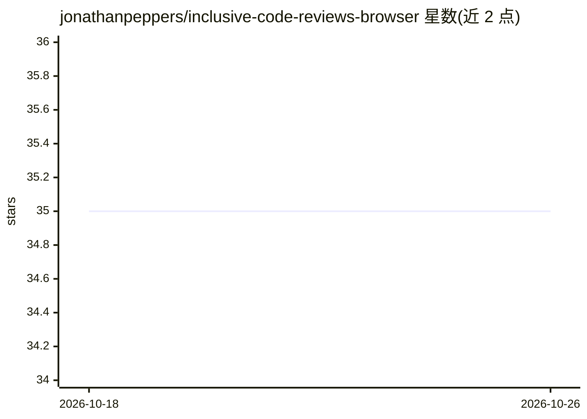

# jonathanpeppers/inclusive-code-reviews-browser

⭐ 35 · JavaScript · LGPL-2.1 · 推送 2026-10-19 · [GitHub](https://github.com/jonathanpeppers/inclusive-code-reviews-browser) · 个人维护

**浏览器扩展：发评论前提示改写不包容措辞**

面向 GitHub 与 Azure DevOps 的 Chrome/Edge 原型扩展，在用户发表代码评审评论前给出措辞建议：内置常见术语替换表（如 whitelist→allowlist），并用自定义机器学习模型在浏览器扩展内本地做情感分类，文本默认不发送到网络；3.1 版起提供可选的 OpenAI 查询功能，由用户点击按钮决定是否发送文本。收集匿名遥测数据。建议词表位于 suggestions.js，可通过 PR 扩充。

## 筛选速览

| 维度 | 判定 | 备注 |
|---|---|---|
| AI 角色 | `ai-enhanced` | 去掉 AI 部分产品仍成立 |
| 许可风险 | `viral` | LGPL-2.1 |
| 部署形态 | `library` | 以包/库形式分发 |
| 模型依赖 | — | README 未给出锁定关系 |
| 硬件要求 | — | 无带数字的原话,不猜 |
| 安装摩擦 | `low` | 无编译、无系统依赖或容器化 |
| 成熟度 | `idea` | |

## 能力要点

- 评论发布前给出措辞替换建议（whitelist→allowlist 等）
- 自定义情感分类模型在扩展内本地运行，文本默认不上网
- 3.1+ 版本可选调用 OpenAI 获取改写建议，发送与否由用户控制
- 词表 suggestions.js 开放 PR 扩充

## 适用场景

- 在 GitHub/Azure DevOps 评审中提前发现并修正不包容措辞
- 团队希望评审评论更友好、减少负面语气

## 场景标签

 · 领域:开发者工具/浏览器扩展

## 证据(README 行号)

> L26: classified by [our custom machine learning model][model]. We are
> L31: Note that the model runs *inside* the browser extension, and your actual text is

## 星数曲线

2026-10-18 35 → 2026-10-26 35（+0）

---
*卡片 v1 · prompt 1.4 · 生成 2026-10-25 · 置信度 mid · 依据 README sha `120e5e066e8d` · [字段定义](../../DATASET.md)*
