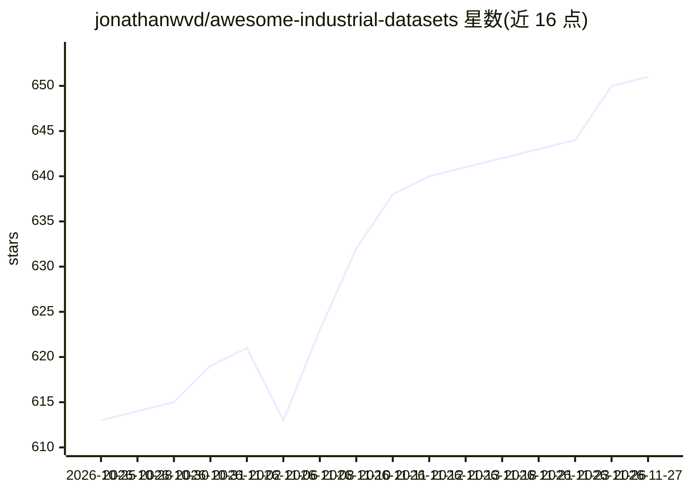

# jonathanwvd/awesome-industrial-datasets

⭐ 651 · NOASSERTION · 推送 2026-11-21 · [GitHub](https://github.com/jonathanwvd/awesome-industrial-datasets) · 个人维护

**面向研究者的公开工业数据集编目清单（398 条）**

收录公开工业数据集的策展清单，共 398 条，覆盖化工、能源、制造、油气、航空航天、物流、OT 安全等领域。每条按领域、资产/流程、模态、任务、获取途径、年份与许可证组织成表格，任务类型包括预测、故障诊断、异常检测、RUL 预测、入侵检测等，获取途径涉及 Zenodo、UCI、Kaggle、Hugging Face、IEEE DataPort 等。面向从事机器建模与分析研究的工程师、科研人员与数据科学家。作者另有 PlantCraft 软件套件。

## 筛选速览

| 维度 | 判定 | 备注 |
|---|---|---|
| AI 角色 | `ai-knowledge` | 知识聚合/清单类 |
| 许可风险 | `none` | NOASSERTION |
| 部署形态 | `None` |  |
| 模型依赖 | — | README 未给出锁定关系 |
| 硬件要求 | — | 无带数字的原话,不猜 |
| 安装摩擦 | `low` | 无编译、无系统依赖或容器化 |
| 成熟度 | — | 结构信号不足 |

## 能力要点

- 398 条数据集按领域/模态/任务/许可证等字段编目
- 覆盖能源、制造、化工、油气、航天、OT 安全等多行业
- 任务类型含预测、异常检测、RUL 与入侵检测等

## 适用场景

- 为工业预测性维护课题查找公开数据集
- 为时间序列或图像缺陷检测研究选数据集
- 按许可证与获取途径筛选可用数据

## 场景标签

`精选清单` · 领域:学习与行业

## 证据(README 行号)

> L5: Welcome to the Awesome Industrial Datasets repository! This project aims to simplify the access to high-quality indu
> L17: **Total Datasets:** 398

## 星数曲线

2026-10-25 613 → 2026-11-27 651（+38）

---
*卡片 v1 · prompt 1.4 · 生成 2026-11-24 · 置信度 high · 依据 README sha `7f74129b7fe6` · [字段定义](../../DATASET.md)*
