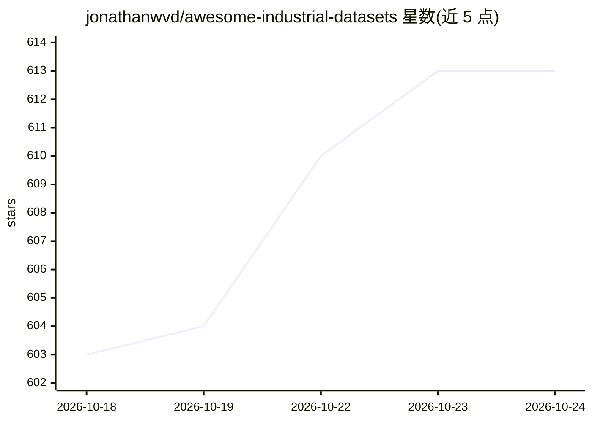

# jonathanwvd/awesome-industrial-datasets

⭐ 613 · Python · NOASSERTION · 推送 2026-10-19 · [GitHub](https://github.com/jonathanwvd/awesome-industrial-datasets) · 个人维护

**工业领域公开数据集策展清单（190 条，多行业）**

面向研究人员、工程师与数据科学家的工业数据集聚合清单：收录 190 个公开数据集，覆盖化工、机械、油气、能源、航空航天、交通、基建等领域。条目以表格组织，标注领域、资产/工艺、模态（图像/时序/表格等）、任务（异常检测、故障诊断、剩余寿命预测、缺陷检测等）、标注类型、来源类型、获取渠道（UCI/Kaggle/Hugging Face/Zenodo 等）、规模、年份与许可证；提供 HTML 版本用于导航。

## 筛选速览

| 维度 | 判定 | 备注 |
|---|---|---|
| AI 角色 | `ai-knowledge` | 知识聚合/清单类 |
| 许可风险 | `none` | NOASSERTION |
| 部署形态 | `None` |  |
| 模型依赖 | — | README 未给出锁定关系 |
| 硬件要求 | — | 无带数字的原话,不猜 |
| 安装摩擦 | `low` | 无编译、无系统依赖或容器化 |
| 成熟度 | — | 结构信号不足 |

## 能力要点

- 收录 190 个跨行业工业数据集
- 表格标注模态、任务、标注类型、获取渠道、规模与许可证等字段
- 覆盖异常检测、故障诊断、预测性维护、缺陷检测等任务
- 提供 HTML 版本改善导航

## 适用场景

- 为工业异常检测或故障诊断模型寻找训练数据
- 按领域（油气、化工、制造等）与任务筛选公开数据集
- 比较各数据集的规模、来源渠道与许可证后再获取

## 场景标签

`精选清单` · 领域:学习与行业

## 证据(README 行号)

> L5: Welcome to the Awesome Industrial Datasets repository! This project aims to simplify the access to high-quality indu
> L11: **Total Datasets:** 190

## 星数曲线

2026-10-18 603 → 2026-10-24 613（+10）

---
*卡片 v1 · prompt 1.4 · 生成 2026-10-21 · 置信度 high · 依据 README sha `5690ec52ceee` · [字段定义](../../DATASET.md)*
