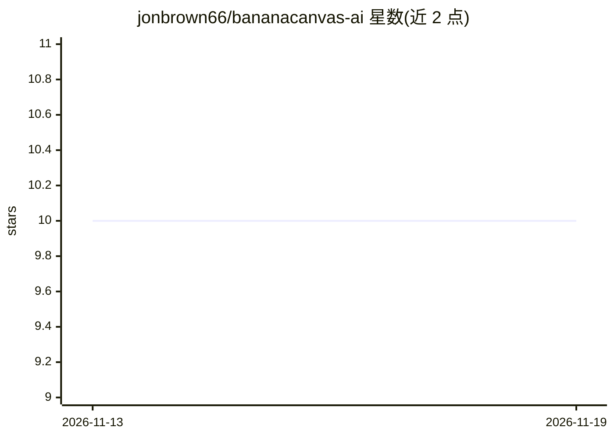

# jonbrown66/bananacanvas-ai

⭐ 10 · TypeScript · MIT · 推送 2026-11-09 · [GitHub](https://github.com/jonbrown66/bananacanvas-ai) · [官网](https://bananacanvas-ai.vercel.app) · 个人维护

**面向创作者的对话式 AI 生成加无限画布工作区**

基于 Next.js 15 与 Supabase 构建的 AI 创作工作区，将对话式 AI 交互与可缩放的无限节点画布结合，用于生成、编辑与组织多模态内容。AI 引擎接入 Google Gemini 与 Flux 生成图像；前端采用客户端透明 WebP 压缩与异步解码以控制图像负载；内置基于 Supabase 的支付与计费体系，并通过数据库行级安全（RLS）隔离用户的提示词与生成内容。需自备 Supabase 项目与 Gemini API Key 部署。

## 筛选速览

| 维度 | 判定 | 备注 |
|---|---|---|
| AI 角色 | `ai-native` | 本体是模型或模型工具 |
| 许可风险 | `permissive` | MIT |
| 部署形态 | `library` | 以包/库形式分发 |
| 模型依赖 | — | README 未给出锁定关系 |
| 硬件要求 | — | 无带数字的原话,不猜 |
| 安装摩擦 | `low` | 无编译、无系统依赖或容器化 |
| 成熟度 | — | 结构信号不足 |

## 能力要点

- 聊天线程与无限节点画布双模式切换，节点自动建立概念连接
- 客户端 WebP 压缩与 decoding=async 异步解码
- 内置接入 Supabase 的 SaaS 支付计费体系
- Supabase RLS 数据库级权限隔离

## 适用场景

- 在无限画布上整理与生成 AI 图像素材
- 搭建带计费的多模态 AI 创作站点
- 将 AI 生成内容以节点方式做知识结构化

## 场景标签

`图像生成` · 领域:内容生成

## 证据(README 行号)

> L14: **BananaCanvas AI** is an advanced enterprise-grade AI creation workspace. It uniquely blends real-time conversatio
> L29: - **AI Engine**: Google Generative AI (Gemini 3.1 Flash Image preview / Flux)

## 星数曲线

2026-11-13 10 → 2026-11-19 10（+0）

---
*卡片 v1 · prompt 1.4 · 生成 2026-11-19 · 置信度 high · 依据 README sha `975935ab3df3` · [字段定义](../../DATASET.md)*
