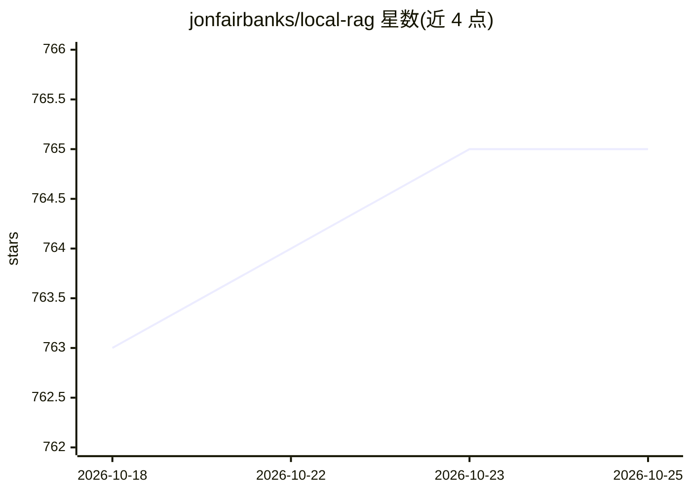

# jonfairbanks/local-rag

⭐ 765 · Python · GPL-3.0 · 推送 2026-10-20 · [GitHub](https://github.com/jonfairbanks/local-rag) · 个人维护

**本地离线 RAG 应用：用 Ollama 模型对本地文件问答**

开源的检索增强生成（RAG）应用：支持摄取本地文件、GitHub 仓库和网站作为知识源，使用本地 Ollama 聊天模型与 Ollama 或 Hugging Face 嵌入模型，通过 LlamaIndex 实现流式 RAG 回答。聊天记录、嵌入与索引内容均保留在本机或本网络内，不依赖第三方、敏感数据不出网。另提供浏览器本地设置持久化、聊天历史导出，以及对上传、URL、仓库与摄取的防护限制。面向需要在网络内自建问答的开发者与团队。

## 筛选速览

| 维度 | 判定 | 备注 |
|---|---|---|
| AI 角色 | `ai-native` | 本体是模型或模型工具 |
| 许可风险 | `viral` | GPL-3.0 |
| 部署形态 | `None` |  |
| 模型依赖 | local-ok | 支持本地模型 |
| 硬件要求 | — | 无带数字的原话,不猜 |
| 安装摩擦 | `low` | 无编译、无系统依赖或容器化 |
| 成熟度 | — | 结构信号不足 |

## 能力要点

- 本地文件、GitHub 仓库、网站三类摄取来源
- Ollama 聊天模型与 Ollama/Hugging Face 嵌入模型
- 数据（聊天/嵌入/索引）不出本机或本网络
- 基于 LlamaIndex 的流式 RAG 回答

## 适用场景

- 在内网对本地文档做问答，数据不出网
- 将 GitHub 仓库或网站内容建为可检索知识库
- 用本地开源模型替代第三方 RAG 服务

## 场景标签

`RAG` `文档问答` · 领域:知识与检索

## 证据(README 行号)

> L12: Ingest local files, GitHub repositories, and websites for retrieval augmented generation (RAG) with local Ollama mo
> L22: - Streaming RAG responses through LlamaIndex

## 星数曲线

2026-10-18 763 → 2026-10-25 765（+2）

---
*卡片 v1 · prompt 1.4 · 生成 2026-10-21 · 置信度 high · 依据 README sha `76bb7e5212b6` · [字段定义](../../DATASET.md)*
