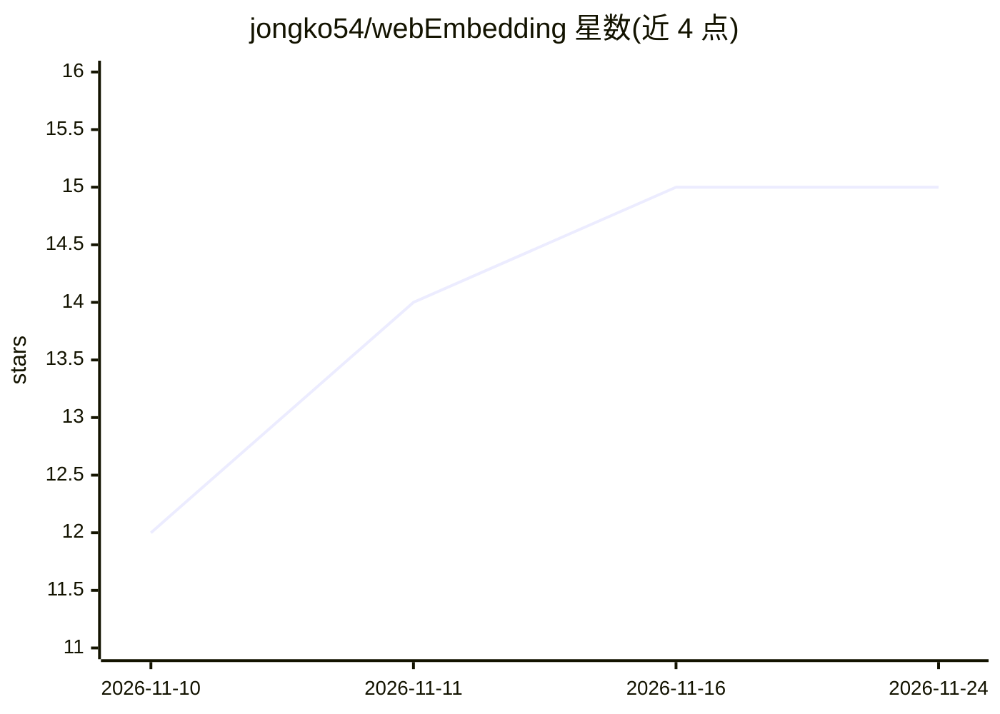

# jongko54/webEmbedding

⭐ 15 · Python · MIT · 推送 2026-11-08 · [GitHub](https://github.com/jongko54/webEmbedding) · 个人维护

**给 AI 编程 agent 的网页克隆引擎：按 URL 生成带自验证的克隆**

以 Skill + MCP server 形式提供的 source-first 网页克隆引擎，供 Claude Code、Codex、Cursor 等 MCP 客户端调用：优先复用可嵌入的原始页面，否则用 Playwright 捕获运行时 DOM/样式/资产/网络证据，生成自包含离线 HTML 快照或有界重建，并按桌面/平板/移动截图做视觉、DOM、交互一致性自验证打分。本地 CLI 与 MCP 走 stdio，另有只做 URL 路由分类的远程 intake 端点。限制：不支持登录页、canvas/WebGL、实时流、支付等场景；需 Node 18+、Python 3.9+、本地 Chrome/Chromium。

## 筛选速览

| 维度 | 判定 | 备注 |
|---|---|---|
| AI 角色 | `ai-ecosystem` | LLM/agent 周边工具 |
| 许可风险 | `permissive` | MIT |
| 部署形态 | `library` | 以包/库形式分发 |
| 模型依赖 | — | README 未给出锁定关系 |
| 硬件要求 | — | 无带数字的原话,不猜 |
| 安装摩擦 | `low` | 无编译、无系统依赖或容器化 |
| 成熟度 | — | 结构信号不足 |

## 能力要点

- source-first 路由：可嵌入则原样复用，被阻时基于捕获证据做有界重建
- Playwright 捕获 DOM/运行时 HTML/样式/资产/HAR 网络元数据
- 视觉/DOM/计算样式/交互/响应式断点五类自验证与有界自修复循环
- 文件系统异步克隆任务队列与确定性 HAR 回放引擎

## 适用场景

- 让编程 agent 一条命令把网页克隆到本地并报告保真分
- 捕获被 X-Frame-Options/CSP 阻止嵌入的页面并重建离线快照
- 获取桌面/平板/移动三端响应式页面快照

## 场景标签

`浏览器自动化` `网页抓取` · 领域:效率与自动化

## 证据(README 行号)

> L3: **webEmbedding clones any web page from its URL for AI coding agents.** Give Claude Code, Codex, Cursor, or any MCP 
> L16: It ships as a Skill + MCP server. Instead of asking a model to "clone this site" from a screenshot, it inspects the

## 星数曲线

2026-11-10 12 → 2026-11-24 15（+3）

---
*卡片 v1 · prompt 1.4 · 生成 2026-11-18 · 置信度 high · 依据 README sha `c4ebe7b00d68` · [字段定义](../../DATASET.md)*
