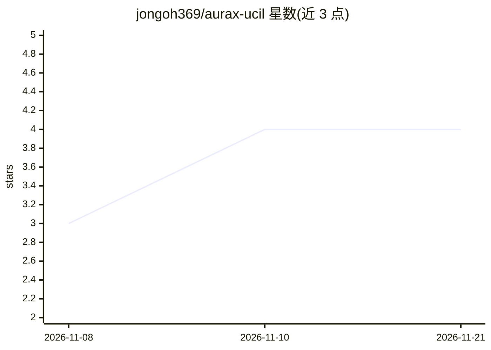

# jongoh369/aurax-ucil

⭐ 4 · Python · NOASSERTION · 推送 2026-11-10 · [GitHub](https://github.com/jongoh369/aurax-ucil) · 个人维护

**给生成式 AI 工作流提供防止回归的 DPC 护栏工具包**

AuraX-UCIL Community Edition 是开源的护栏引擎，实现差分保持契约（DPC），用于防止生成式 AI 工作流中文档修正引发的原有条款丢失。机制包括提取 NUMERIC、TEMPORAL、INTENT、SEMANTIC 多属性通信身份的确定性管线，以及双门非回归检查，使必需更新得以应用且不破坏既有条款。面向开发者和企业文档修订场景，Windows 下双击 bat 脚本即可本地启动并打开浏览器界面。许可为 Apache 2.0，声明限个人、学术与非商业开源使用。

## 筛选速览

| 维度 | 判定 | 备注 |
|---|---|---|
| AI 角色 | `ai-ecosystem` | LLM/agent 周边工具 |
| 许可风险 | `none` | NOASSERTION |
| 部署形态 | `None` |  |
| 模型依赖 | — | README 未给出锁定关系 |
| 硬件要求 | — | 无带数字的原话,不猜 |
| 安装摩擦 | `low` | 无编译、无系统依赖或容器化 |
| 成熟度 | — | 结构信号不足 |

## 能力要点

- 实现差分保持契约（DPC）防止修正引发的回归
- 提取 NUMERIC/TEMPORAL/INTENT/SEMANTIC 四类通信身份
- 双门非回归检查：应用更新同时保护既有条款
- Windows 双击 start_ucil.bat 一键本地运行

## 适用场景

- 生成式 AI 修订合同文档时防止原有条款被破坏
- 企业文档修正流程中核验关键属性未被丢失
- 本地部署一套文档修订回归检查服务

## 场景标签

 · 领域:LLM 基础设施/法律文档安全

## 证据(README 行号)

> L2: > **Open-Source Non-Regression Guardrail Engine for LLMs and AI Document Amendment**
> L4: AuraX-UCIL Community Edition is a free, developer-friendly open-source toolkit implementing Differential Preservatio

## 星数曲线

2026-11-08 3 → 2026-11-21 4（+1）

---
*卡片 v1 · prompt 1.4 · 生成 2026-11-21 · 置信度 mid · 依据 README sha `594964ea5181` · [字段定义](../../DATASET.md)*
