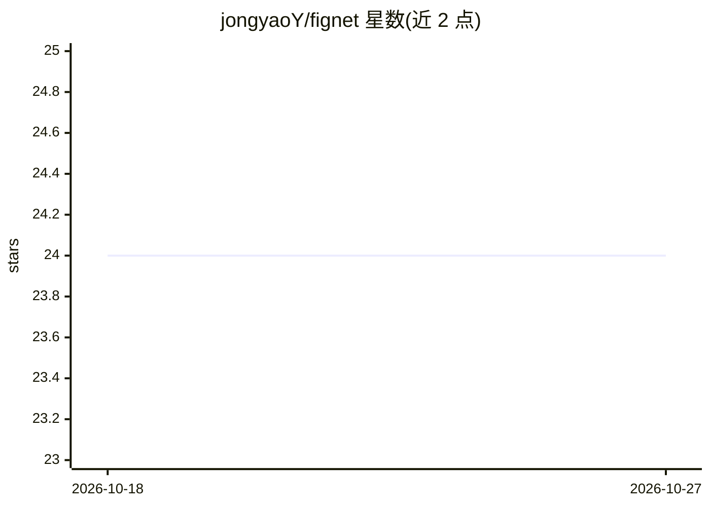

# jongyaoY/fignet

⭐ 24 · Python · MIT · 推送 2026-03-23 · [GitHub](https://github.com/jongyaoY/fignet) · 个人维护

**FIGNet 刚体动力学模拟器的 PyTorch 第三方复现实现**

对论文《Learning Rigid Dynamics with Face Interaction Graph Networks》及后续 FIGNet* 工作的第三方 PyTorch 复现：用图神经网络模拟刚体动力学，含 mesh 节点与 face-face 碰撞边（hpp-fcl 碰撞检测）、可选省略 mesh-mesh 边以提升可扩展性。提供数据生成（MuJoCo+robosuite，100k 回合/1M 步）、训练、渲染脚本与预训练权重。依赖较重：需源码安装 hpp-fcl、PyTorch3D、torch-scatter，作者声明仍处早期实验阶段，不保证复现论文结果。

## 筛选速览

| 维度 | 判定 | 备注 |
|---|---|---|
| AI 角色 | `ai-native` | 本体是模型或模型工具 |
| 许可风险 | `permissive` | MIT |
| 部署形态 | `library` | 以包/库形式分发 |
| 模型依赖 | — | README 未给出锁定关系 |
| 硬件要求 | — | 无带数字的原话,不猜 |
| 安装摩擦 | `medium` | 含编译或系统依赖之一 |
| 成熟度 | `idea` | |

## 能力要点

- 基于 face-face 交互图的刚体动力学 GNN 模拟，含 FIGNet* 改进
- MuJoCo+robosuite 数据生成管线，物体属性随机化
- 提供数据生成、预计算图、训练、轨迹渲染脚本与多组预训练权重
- 支持省略 mesh-mesh 边以提升内存效率与可扩展性

## 适用场景

- 复现或学习 FIGNet 论文的刚体动力学模拟
- 用 GNN 预测多刚体碰撞与轨迹并生成对比动画
- 基于预训练权重做新物体/新环境的迁移测试

## 场景标签

 · 领域:机器学习/物理仿真

## 证据(README 行号)

> L18: This repo is a **third party** implementation of the **FIGNet** [Learning Rigid Dynamics
> L21: results from the original paper. The package also includes the improvement
> L30: - Pytorch

## 星数曲线

2026-10-18 24 → 2026-10-27 24（+0）

---
*卡片 v1 · prompt 1.4 · 生成 2026-10-27 · 置信度 high · 依据 README sha `10be4fe260a2` · [字段定义](../../DATASET.md)*
