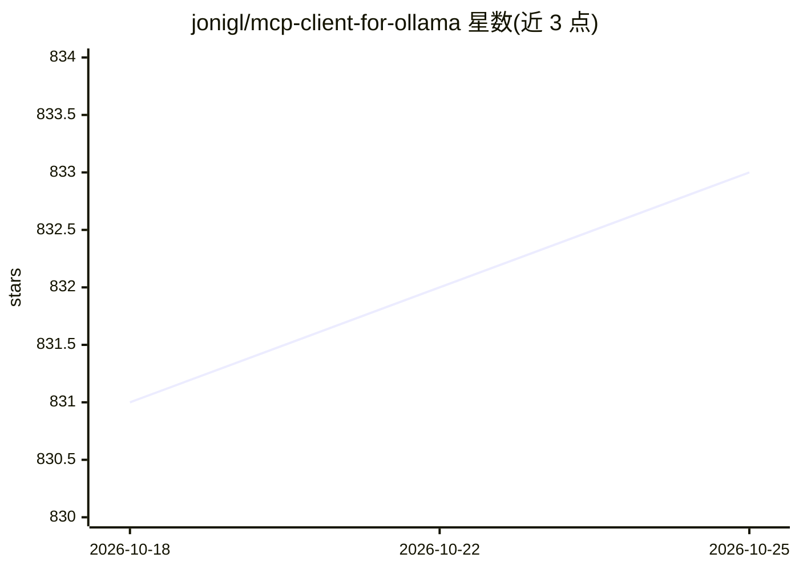

# jonigl/mcp-client-for-ollama

⭐ 832 · Python · MIT · 推送 2026-10-13 · [GitHub](https://github.com/jonigl/mcp-client-for-ollama) · 个人维护 · 中文 README

**连接本地 Ollama 与 MCP 服务器的终端客户端**

Python 编写的交互式终端应用（TUI），将本地 Ollama 模型连接到多个 MCP 服务器，支持 tools/prompts/resources 三类 MCP 原语，覆盖 STDIO/SSE/Streamable HTTP 传输。功能包括 Agent 模式迭代工具调用、Human-in-the-Loop 工具执行审批、流式输出、思考模式、模型参数配置（15+ 项）、动态模型切换、MCP 服务器热重载与历史导出。除 Ollama 外也支持 OpenAI 兼容提供方（OpenAI、OpenRouter、DeepSeek 等）及 Ollama Cloud。要求 Python 3.11+，经 pip/uv 安装或源码运行。

## 筛选速览

| 维度 | 判定 | 备注 |
|---|---|---|
| AI 角色 | `ai-ecosystem` | LLM/agent 周边工具 |
| 许可风险 | `permissive` | MIT |
| 部署形态 | `library` | 以包/库形式分发 |
| 模型依赖 | local-ok | 支持本地模型 |
| 硬件要求 | — | 无带数字的原话,不猜 |
| 安装摩擦 | `low` | 无编译、无系统依赖或容器化 |
| 成熟度 | — | 结构信号不足 |

## 能力要点

- 支持 MCP tools/prompts/resources 原语与多服务器连接（STDIO/SSE/HTTP）
- Agent 模式迭代工具调用与 Human-in-the-Loop 执行审批
- CLI 管理 MCP 服务器配置，project 作用域写入兼容 Claude Code 的 .mcp.json
- 支持 Ollama、OpenAI 兼容提供方与 Ollama Cloud 多推理来源

## 适用场景

- 在终端中让本地 Ollama 模型调用 MCP 工具执行任务
- 开发/测试 MCP 服务器时热重载并逐个审批工具调用
- 通过 ollmcp mcp add 命令管理本地/项目级 MCP 服务器配置

## 场景标签

`AI 助手` · 领域:对话与助手

## 证据(README 行号)

> L1: A simple yet powerful Python client for interacting with Model Context Protocol (MCP) servers using Ollama, allowing
> L31: MCP Client for Ollama (ollmcp) is a modern, interactive terminal application (TUI) built for harness engineering, c
> L41: - 🌍 **Multiple LLM Providers**: Use Ollama (default) or OpenAI-compatible providers (OpenAI, OpenRouter, DeepSeek, 

## 星数曲线

2026-10-18 831 → 2026-10-25 833（+2）

---
*卡片 v1 · prompt 1.4 · 生成 2026-10-21 · 置信度 mid · 依据 README sha `428f8b43b4c6` · [字段定义](../../DATASET.md)*
