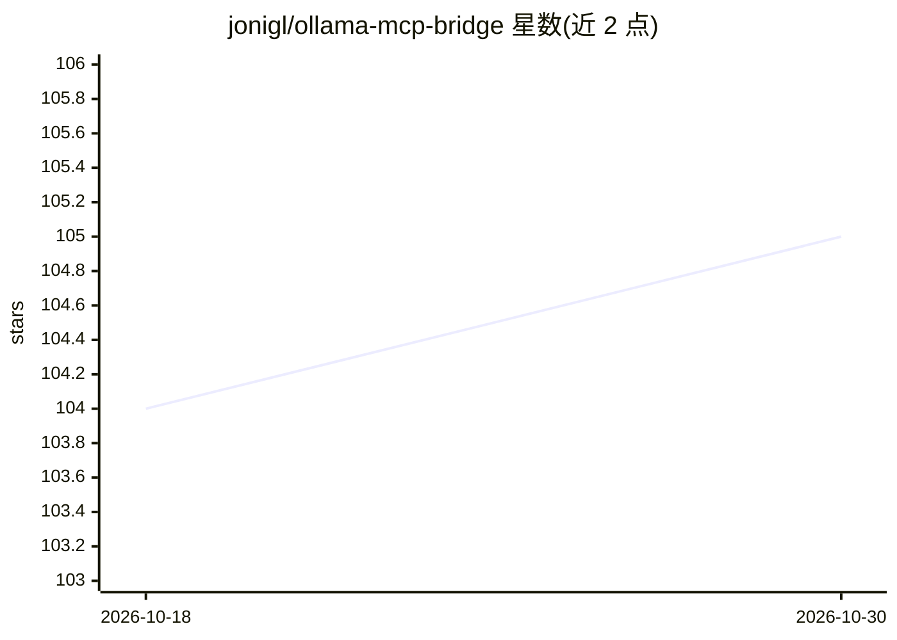

# jonigl/ollama-mcp-bridge

⭐ 105 · Python · MIT · 推送 2026-09-25 · [GitHub](https://github.com/jonigl/ollama-mcp-bridge) · [官网](https://jonigl.github.io/ollama-mcp-bridge/) · 个人维护

**在 Ollama API 前接入多 MCP 服务器工具的桥接层**

面向本地 LLM 应用开发者的 API 代理桥：启动时按 JSON 配置连接多个 MCP 服务器（stdio/StreamableHTTP/SSE 三种传输），在 `/api/chat` 端点将全部可用工具注入请求，自动循环执行 Ollama 发起的工具调用并把结果回传，直至完成；其余 Ollama 端点不做修改地透明代理。支持工具过滤（include/exclude）、`${env:}` 与 `${workspaceFolder}` 变量展开、流式响应、thinking 消息代理、云模型、自定义上游头与系统提示。限制：仅 `/api/chat` 集成工具；需自行运行 Ollama 服务器并提供含至少一个 MCP 服务器的配置文件。

## 筛选速览

| 维度 | 判定 | 备注 |
|---|---|---|
| AI 角色 | `ai-ecosystem` | LLM/agent 周边工具 |
| 许可风险 | `permissive` | MIT |
| 部署形态 | `self-host` | docker 或自建部署 |
| 模型依赖 | local-ok | 支持本地模型 |
| 硬件要求 | — | 无带数字的原话,不猜 |
| 安装摩擦 | `low` | 无编译、无系统依赖或容器化 |
| 成熟度 | — | 结构信号不足 |

## 能力要点

- 多 MCP 服务器工具聚合，经 /api/chat 注入 Ollama 请求
- stdio / StreamableHTTP / SSE 三种 MCP 传输方式
- 多轮工具调用自动循环执行，可设最大轮数上限
- 多架构 Docker 镜像（amd64/arm64）发布至 GHCR

## 适用场景

- 让本地 Ollama 模型无需改代码即可调用多个 MCP 工具
- 为本地 AI agent 或自定义聊天机器人构建工具调用后端
- 在 Docker 部署中统一管理 Ollama 与 MCP 工具服务器配置

## 场景标签

`Agent 框架` · 领域:Agent 开发

## 证据(README 行号)

> L1: Provides an API layer in front of the Ollama API, seamlessly adding tools from multiple MCP servers so every Ollama 
> L137: 4. **Chat Completion Request (`/api/chat` endpoint only)**: When a chat completion request is received on `/api/ch
> L145: 5. **Other Endpoints**: All other endpoints (except `/api/chat`, `/health`, and `/version`) are fully proxied to t

## 星数曲线

2026-10-18 104 → 2026-10-30 105（+1）

---
*卡片 v1 · prompt 1.4 · 生成 2026-10-23 · 置信度 high · 依据 README sha `f0ae45908511` · [字段定义](../../DATASET.md)*
