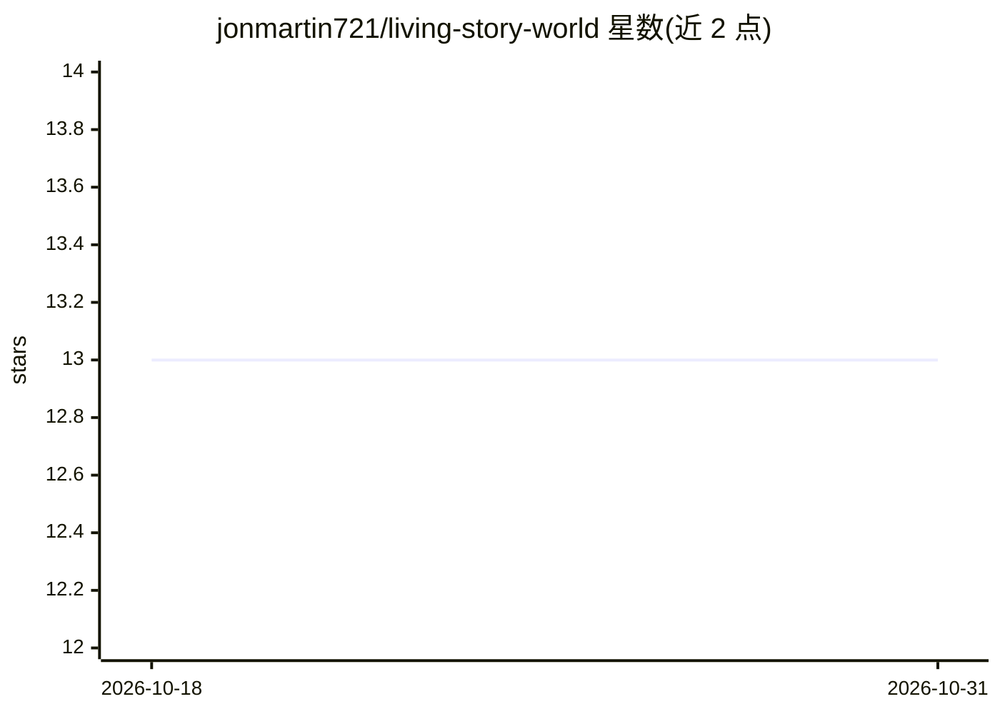

# jonmartin721/living-story-world

⭐ 13 · Python · MIT · 推送 2026-09-21 · [GitHub](https://github.com/jonmartin721/living-story-world) · 个人维护

**生成带插图的互动式连载故事的 AI 叙事引擎，供个人用户使用**

基于 Python/FastAPI 的持久叙事宇宙生成器：逐章生成带插图的文本，通过实体知识图谱与分层上下文注入（记忆、作者注、章节摘要等）维持跨章节的角色/地点记忆，并在关键节点提供分支选项。文本生成支持 Ollama、本地 OpenAI 兼容服务器、OpenAI、Groq、Together AI、HuggingFace、OpenRouter、Gemini；图像生成支持 ComfyUI、AI Horde、Replicate、Pollinations、fal.ai 等。新装默认使用 Ollama 本地生成（关闭插图），无需付费 API。提供 Web、TUI、CLI 三种界面，Releases 提供预构建可执行文件。世界状态以 JSON 文件持久化。

## 筛选速览

| 维度 | 判定 | 备注 |
|---|---|---|
| AI 角色 | `ai-native` | 本体是模型或模型工具 |
| 许可风险 | `permissive` | MIT |
| 部署形态 | `library` | 以包/库形式分发 |
| 模型依赖 | local-ok | 支持本地模型 |
| 硬件要求 | — | 无带数字的原话,不猜 |
| 安装摩擦 | `low` | 无编译、无系统依赖或容器化 |
| 成熟度 | — | 结构信号不足 |

## 能力要点

- 跨章节实体知识图谱持久记忆（角色/地点/情节线）
- 多文本与图像 provider 可切换（Ollama/本地 OpenAI 兼容/云服务）
- NovelAI 风格的分层上下文注入系统
- 8 种插画风格与 12 种叙事类型预设

## 适用场景

- 生成有持续记忆的连载互动小说并做分支选择
- 用本地模型（Ollama/ComfyUI）离线生成带插图的故事
- 对比不同 AI provider 的叙事输出

## 场景标签

`AI 写作` `图像生成` · 领域:内容生成

## 证据(README 行号)

> L12: An AI storytelling engine that writes illustrated chapters while maintaining memory. Characters remember past event
> L93: - **Persistent Memory** - Stories remember characters and locations across chapters (entity graph tracks continuity

## 星数曲线

2026-10-18 13 → 2026-10-31 13（+0）

---
*卡片 v1 · prompt 1.4 · 生成 2026-10-31 · 置信度 mid · 依据 README sha `c2704268d34b` · [字段定义](../../DATASET.md)*
