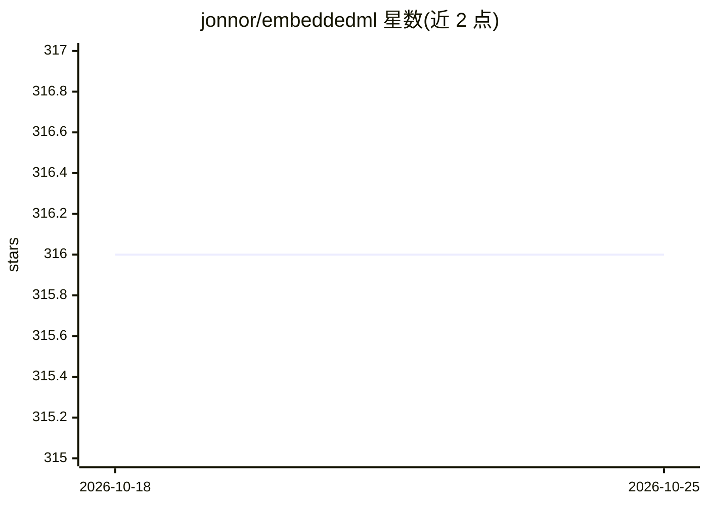

# jonnor/embeddedml

⭐ 316 · Jupyter Notebook · 推送 2026-09-24 · [GitHub](https://github.com/jonnor/embeddedml) · 个人维护

**嵌入式/TinyML 笔记仓库：边缘侧机器学习知识整理**

个人维护的机器学习在微控制器与嵌入式设备上运行的笔记集：阐述端侧推理相对云端处理的价值场景与动机（延迟、隐私、带宽、能耗），列举预测性维护、活动检测、NILM、唤醒词检测等应用案例，并整理开源与商业工具清单（emlearn、TensorFlow Lite for Microcontrollers、onnx2c、microTVM 等）、适用模型类型、2019 年技术现状与局限。附有作者的演讲、讲义与项目记录，无安装运行内容。

## 筛选速览

| 维度 | 判定 | 备注 |
|---|---|---|
| AI 角色 | `ai-knowledge` | 知识聚合/清单类 |
| 许可风险 | `none` | — |
| 部署形态 | `None` |  |
| 模型依赖 | — | README 未给出锁定关系 |
| 硬件要求 | — | 无带数字的原话,不猜 |
| 安装摩擦 | `low` | 无编译、无系统依赖或容器化 |
| 成熟度 | — | 结构信号不足 |

## 能力要点

- 端侧 ML 适用场景与动机的系统性笔记（延迟/隐私/带宽/能耗）
- 覆盖开源、专有、历史三类的嵌入式 ML 工具清单与简评
- 十余个端侧 ML 应用案例（预测性维护、NILM、唤醒词等）
- 记录 2019 年微控制器 ML 推理的现状与局限

## 适用场景

- 评估传感器/物联网项目是否适合在设备端做机器学习推理
- 选型时查阅微控制器端 ML 推理工具与运行时的清单
- 了解 TinyML 的典型应用场景与技术局限

## 场景标签

`知识库管理` `精选清单` `教程课程` · 领域:知识与检索

## 证据(README 行号)

> L1: # Machine learning on embedded devices
> L3: Focused primarily on running inference/prediction/feed-forward part on a microcontroller (or small embedded device).
> L120: # Tools

## 星数曲线

2026-10-18 316 → 2026-10-25 316（+0）

---
*卡片 v1 · prompt 1.4 · 生成 2026-10-22 · 置信度 high · 依据 README sha `e715cbf0abd7` · [字段定义](../../DATASET.md)*
