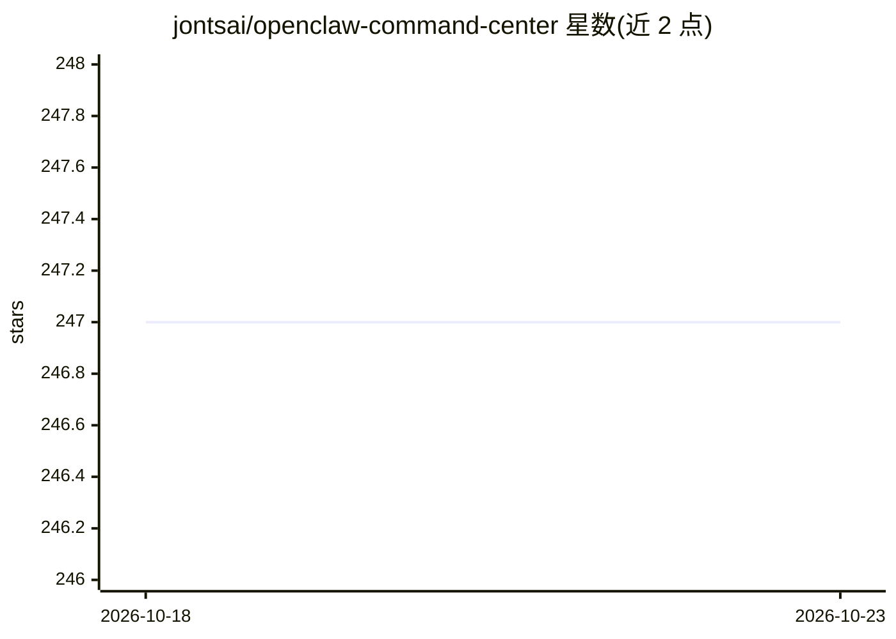

# jontsai/openclaw-command-center

⭐ 247 · JavaScript · MIT · 推送 2026-10-06 · [GitHub](https://github.com/jontsai/openclaw-command-center) · [官网](https://clawhub.ai/jontsai/command-center) · 个人维护 · 中文 README

**OpenClaw AI agent 部署的实时监控仪表盘**

面向运行 OpenClaw AI agent 的用户，提供一个基于 Node.js 的本地 Web 仪表盘：实时监控会话、Token 用量与成本、系统资源（CPU/内存/磁盘/温度）、定时任务、对话主题（Cerebro）、操作者与 agent 记忆文件。通过统一状态 API 与 SSE 实现约 2 秒实时更新；默认只读、绑定 127.0.0.1，支持 token/Tailscale/Cloudflare/IP 白名单认证；无需构建步骤与运行时依赖，仅需 Node.js。安装经 npx clawhub 或 git clone 后运行。

## 筛选速览

| 维度 | 判定 | 备注 |
|---|---|---|
| AI 角色 | `ai-ecosystem` | LLM/agent 周边工具 |
| 许可风险 | `permissive` | MIT |
| 部署形态 | `library` | 以包/库形式分发 |
| 模型依赖 | — | README 未给出锁定关系 |
| 硬件要求 | — | 无带数字的原话,不猜 |
| 安装摩擦 | `low` | 无编译、无系统依赖或容器化 |
| 成熟度 | — | 结构信号不足 |

## 能力要点

- 统一状态端点与 SSE 实时更新（非轮询）
- 会话、成本、系统资源、cron 任务、主题与记忆文件的全景监控
- 仅依赖 Node.js，无构建步骤、零用户依赖
- 多种认证模式与隐私控制（隐藏敏感主题/会话）

## 适用场景

- 7x24 运行的 AI agent 部署需要随时查看在做什么
- 追踪多会话 Token 消耗与各模型成本明细
- 查看和启停定时任务并回顾运行历史

## 场景标签

`LLM 可观测性` · 领域:评测与运维

## 证据(README 行号)

> L57: Command Center gives you **real-time visibility** into your OpenClaw deployment — sessions, costs, system health, s
> L110: |📊 **Session Monitoring**|Real-time view of active AI sessions|

## 星数曲线

2026-10-18 247 → 2026-10-23 247（+0）

---
*卡片 v1 · prompt 1.4 · 生成 2026-10-22 · 置信度 high · 依据 README sha `4ecbbca094d8` · [字段定义](../../DATASET.md)*
