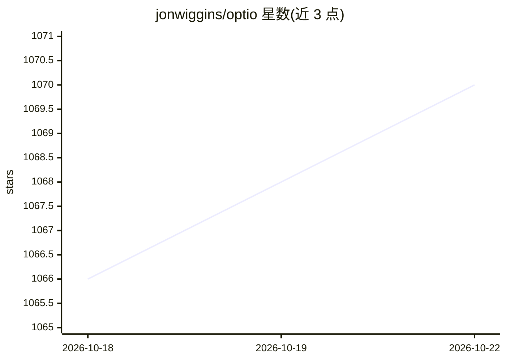

# jonwiggins/optio

⭐ 1,071 · TypeScript · MIT · 推送 2026-10-21 · [GitHub](https://github.com/jonwiggins/optio) · [官网](https://optio.host/) · 个人维护

**自托管的编码 agent 编排平台：统一调度与跟进 agent 任务**

部署在用户自有 Kubernetes 集群或本机的编码 agent 编排层：支持 Claude Code、OpenAI Codex、GitHub Copilot、Gemini、Cursor、OpenCode、OpenClaw 或纯 shell 作为执行运行时；以 14 种触发方式（手动/定时/webhook/工单/事件等）启动工作，在 repo worktree 中执行、开 PR、按计划生成简报、响应告警事件。提供 iOS/Android 原生应用、会话共享、Optio Local 配对本机执行、Helm 部署与角色/凭证管理。API/web 部署目前要求单副本。

## 筛选速览

| 维度 | 判定 | 备注 |
|---|---|---|
| AI 角色 | `ai-ecosystem` | LLM/agent 周边工具 |
| 许可风险 | `permissive` | MIT |
| 部署形态 | `library` | 以包/库形式分发 |
| 模型依赖 | — | README 未给出锁定关系 |
| 硬件要求 | — | 无带数字的原话,不猜 |
| 安装摩擦 | `low` | 无编译、无系统依赖或容器化 |
| 成熟度 | — | 结构信号不足 |

## 能力要点

- 7 种 agent 运行时加纯 shell 可选，按任务指定运行时
- 14 种触发类型（定时/webhook/GitHub/Slack/PagerDuty/Sentry 等）
- SwiftUI iOS 与 Jetpack Compose Android 原生应用，含小组件与手表集成
- Helm 部署，支持托管 PostgreSQL/Redis、OAuth/OIDC 与加密凭证

## 适用场景

- 让编码 agent 在自有集群里自动完成 issue 到 PR 的全流程
- 用定时任务跑依赖更新和每日简报
- 把 PagerDuty/Sentry 等告警事件转成 agent 调查任务
- 在手机上查看和接管正在运行的 agent 会话

## 场景标签

`编码 Agent` · 领域:编码与开发

## 证据(README 行号)

> L4:  Self-hosted orchestration for coding agents, automated workflows, and interactive sessions. On your Kubernetes clus
> L16: Choose **Claude Code, OpenAI Codex, GitHub Copilot, Google Gemini, Cursor, OpenCode, or OpenClaw**—or run a plain s

## 星数曲线

2026-10-18 1,066 → 2026-10-22 1,070（+4）

---
*卡片 v1 · prompt 1.4 · 生成 2026-10-21 · 置信度 high · 依据 README sha `b736a02ef1ff` · [字段定义](../../DATASET.md)*
