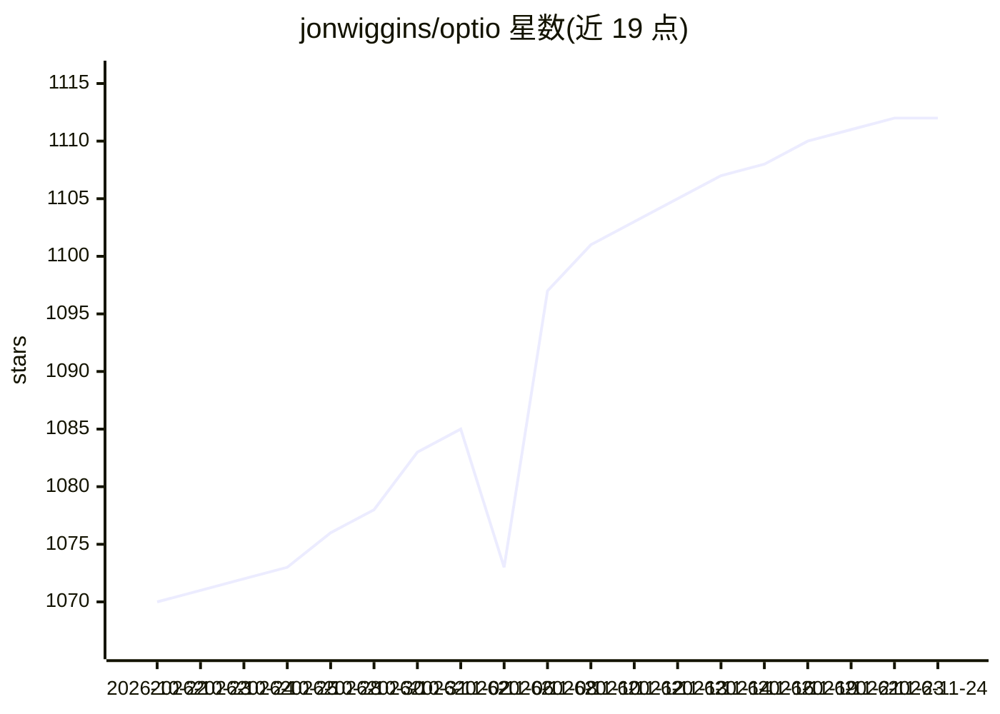

# jonwiggins/optio

⭐ 1,114 · TypeScript · MIT · 推送 2026-11-23 · [GitHub](https://github.com/jonwiggins/optio) · [官网](https://optio.host/) · 个人维护

**自托管的编码 agent 编排层：在 Kubernetes 上统一运行 AI agent 工作流**

Optio 为多个编码 agent 提供共享工作空间与统一调度：支持 15 种触发方式（手动、定时、webhook、GitHub/GitLab 事件、PagerDuty/Sentry 告警、Slack/Linear/Jira 工单等），将任务派发给 Claude Code、Codex、Copilot、Gemini、Cursor、OpenCode 等 agent 运行时或普通 shell 命令，在 Kubernetes pod 或配对的本地机器上执行，并提供会话终端、会话分享、iOS/Android 原生客户端。技术栈为 TypeScript、Next.js、Fastify、PostgreSQL、Redis/BullMQ 与 Kubernetes，通过 git clone 脚本或 Helm 部署，MIT 许可。注意其定位为编排层而非模型服务，模型调用仍走用户配置的外部 provider。

## 筛选速览

| 维度 | 判定 | 备注 |
|---|---|---|
| AI 角色 | `ai-ecosystem` | LLM/agent 周边工具 |
| 许可风险 | `permissive` | MIT |
| 部署形态 | `library` | 以包/库形式分发 |
| 模型依赖 | — | README 未给出锁定关系 |
| 硬件要求 | — | 无带数字的原话,不猜 |
| 安装摩擦 | `low` | 无编译、无系统依赖或容器化 |
| 成熟度 | — | 结构信号不足 |

## 能力要点

- 15 种触发类型（定时、webhook、工单、告警、CI 事件等）驱动 agent 工作
- 支持 Claude Code、Codex、Copilot、Gemini、Cursor、OpenCode 等多种 agent 运行时
- Kubernetes pod 与配对本地机器（Optio Local）两种执行环境
- SwiftUI iOS 与 Jetpack Compose Android 原生客户端，含小组件与 Live Activities

## 适用场景

- 从 issue 或告警事件自动生成 PR 并跟进 CI 与评审
- 定时运行依赖更新、日报等周期性 agent 任务
- 编排多个持久化 agent 通过消息与 API 协作
- 在手机上查看队列、创建任务并控制 agent 终端

## 场景标签

`编码 Agent` `工作流自动化` `多智能体` · 领域:Agent 开发

## 证据(README 行号)

> L4:  Self-hosted orchestration for coding agents, automated workflows, and interactive sessions. On your Kubernetes clus
> L16: Choose **Claude Code, OpenAI Codex, GitHub Copilot, Google Gemini, Cursor, OpenCode, Pi, or OpenClaw**—or run a pla
> L88: Optio is the orchestration layer you host. Agents still communicate with the model providers and external tools you

## 星数曲线

2026-10-22 1,070 → 2026-11-24 1,112（+42）

---
*卡片 v1 · prompt 1.4 · 生成 2026-11-24 · 置信度 high · 依据 README sha `fdaf58b7582d` · [字段定义](../../DATASET.md)*
