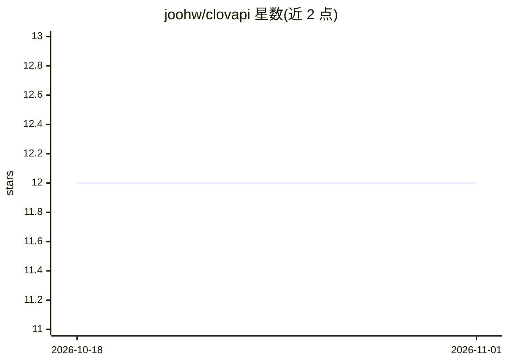

# joohw/clovapi

⭐ 12 · Go · 推送 2026-09-21 · [GitHub](https://github.com/joohw/clovapi) · [官网](https://clovapi.com) · 个人维护 · 中文 README

**共享模型 API 网络：平台 Key 调用在线共享模型，CLI 做贡献节点**

一个共享模型 API 网络：用户在控制台创建平台 API Key 后，通过 OpenAI 兼容的统一接口（/v1/models、/v1/chat/completions、/v1/responses）选择并调用当前在线的共享模型，无需自行安装 CLI 或配置上游。拥有模型资源的用户可运行 clovapi CLI 作为贡献节点：上游地址与密钥保留在节点本地，平台只接收可用模型 ID，经节点出站连接转发请求与流式响应；节点侧支持 OpenAI、Anthropic、Gemini 协议适配，可设每日上限、暂停或断开。原 Agent CLI 配置切换功能已迁移到 clovagent。

## 筛选速览

| 维度 | 判定 | 备注 |
|---|---|---|
| AI 角色 | `ai-ecosystem` | LLM/agent 周边工具 |
| 许可风险 | `none` | — |
| 部署形态 | `library` | 以包/库形式分发 |
| 模型依赖 | — | README 未给出锁定关系 |
| 硬件要求 | — | 无带数字的原话,不猜 |
| 安装摩擦 | `low` | 无编译、无系统依赖或容器化 |
| 成熟度 | — | 结构信号不足 |

## 能力要点

- 一套平台 API Key 经 OpenAI 兼容接口调用在线共享模型
- 贡献节点上游凭据保留本地，平台仅转发请求
- 节点侧支持 OpenAI、Anthropic、Gemini 协议适配
- 贡献节点自动同步本地模型并支持每日上限/暂停

## 适用场景

- 无本地模型资源时通过统一接口调用共享模型
- 把自己的模型资源贡献为网络节点
- 管理多个上游协议并经本地节点转发调用

## 场景标签

`模型网关` · 领域:Agent 开发

## 证据(README 行号)

> L3: clovapi 是一个共享模型 API 网络。用户创建平台 API Key 后，即可通过统一的 OpenAI 兼容接口选择并调用当前在线的共享模型；无需安装 CLI、配置上游或先贡献 API。
> L12: - 通过 `/v1/models` 查看当前可用模型，通过 `/v1/chat/completions` 或 `/v1/responses` 发起调用。
> L15: - 节点侧支持 OpenAI、Anthropic、Gemini 等协议适配，上游凭据不会上传到平台。

## 星数曲线

2026-10-18 12 → 2026-11-01 12（+0）

---
*卡片 v1 · prompt 1.4 · 生成 2026-11-01 · 置信度 high · 依据 README sha `c4d2d7eef947` · [字段定义](../../DATASET.md)*
