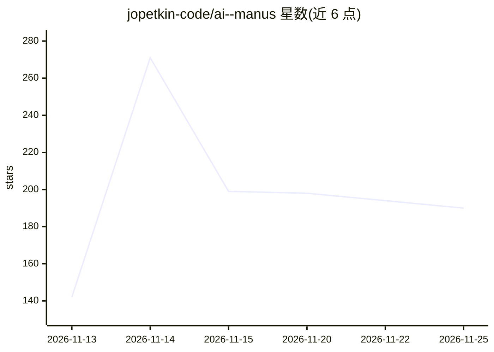

# jopetkin-code/ai--manus

⭐ 190 · Apache-2.0 · 推送 2026-11-14 · [GitHub](https://github.com/jopetkin-code/ai--manus) · 个人维护

**面向个人用户的自主 AI Agent，代跑代码与操控浏览器**

README 描述 Manus 为自主运行的 AI agent：代替用户编写并执行脚本、控制浏览器（导航网页、填写表单、采集信息），可跨代码与浏览器完成多步任务并跨会话复用工作流。定位为家庭、学习与轻量办公场景的小型助手，明确声明不是企业级平台或重型套件。README 以功能宣传为主，未给出架构、模型接入方式、源码构建或安装命令等技术细节，仅在兼容性表列出最低与推荐硬件配置（双核 CPU、4GB/8GB 内存等）与通用的上手步骤。

## 筛选速览

| 维度 | 判定 | 备注 |
|---|---|---|
| AI 角色 | `ai-native` | 本体是模型或模型工具 |
| 许可风险 | `permissive` | Apache-2.0 |
| 部署形态 | `None` |  |
| 模型依赖 | — | README 未给出锁定关系 |
| 硬件要求 | — | 无带数字的原话,不猜 |
| 安装摩擦 | `low` | 无编译、无系统依赖或容器化 |
| 成熟度 | — | 结构信号不足 |

## 能力要点

- 自主执行代码并控制浏览器完成多步任务
- 任务可跨会话记忆并重复执行相同工作流
- 兼容性表给出最低/推荐硬件要求
- 定位为家庭、学习与轻量办公的小规模场景

## 适用场景

- 让 agent 代为查网页、填表单、收集资料
- 把重复的小脚本与浏览器操作委托给后台助手
- 学生学习研究中整理笔记、跑小计算

## 场景标签

`工作流自动化` `AI 助手` `浏览器自动化` · 领域:效率与自动化

## 证据(README 行号)

> L10: - **Autonomous Code Execution:** Manus AI agent runs code on its own to complete tasks, so you can focus on decisio
> L18: Manus is an autonomous AI agent designed to run code and control a browser on your behalf. Instead of acting like a

## 星数曲线

2026-11-13 142 → 2026-11-25 190（+48）

---
*卡片 v1 · prompt 1.4 · 生成 2026-11-17 · 置信度 low · 依据 README sha `544a8e299555` · [字段定义](../../DATASET.md)*
