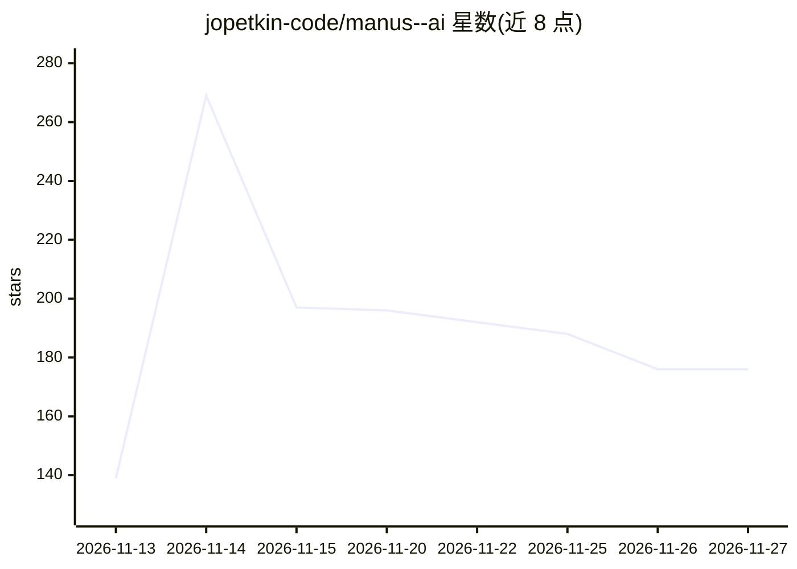

# jopetkin-code/manus--ai

⭐ 176 · Apache-2.0 · 推送 2026-11-14 · [GitHub](https://github.com/jopetkin-code/manus--ai) · 个人维护

**面向个人用户的自主 AI Agent：代跑代码与操作浏览器**

README 以营销式语言介绍 Manus：一个自主 AI agent，可在用户指令下自主编写并执行脚本、控制浏览器完成导航/填表/信息收集等多步骤任务，定位为家庭、学习与轻量办公的个人助理，非企业平台或开发框架。描述其跨会话记住任务模式的能力，并给出硬件兼容表（最低 4GB 内存/双核 CPU）。但 README 未提供任何安装方式、代码结构、模型接入或使用许可信息，仅含'Download Manus'与促销码'PROMO2026'等指向下载页的内容。

## 筛选速览

| 维度 | 判定 | 备注 |
|---|---|---|
| AI 角色 | `ai-native` | 本体是模型或模型工具 |
| 许可风险 | `permissive` | Apache-2.0 |
| 部署形态 | `None` |  |
| 模型依赖 | — | README 未给出锁定关系 |
| 硬件要求 | — | 无带数字的原话,不猜 |
| 安装摩擦 | `low` | 无编译、无系统依赖或容器化 |
| 成熟度 | — | 结构信号不足 |

## 能力要点

- 自主编写并执行代码完成任务
- 浏览器控制：导航网页、填写表单、收集信息
- 代码与浏览器操作可在同一任务流中衔接
- 面向家庭/学习/轻量办公的小规模场景

## 适用场景

- 让 agent 代为执行重复性的代码与浏览器操作
- 研究资料收集与笔记整理
- 多页网页信息汇总，辅助小型报告

## 场景标签

`AI 助手` `浏览器自动化` `编码 Agent` · 领域:效率与自动化

## 证据(README 行号)

> L10: - **Autonomous Code Execution:** Manus AI agent runs code on its own to complete tasks, so you can focus on decisio
> L18: Manus is an autonomous AI agent designed to run code and control a browser on your behalf. Instead of acting like a

## 星数曲线

2026-11-13 139 → 2026-11-27 176（+37）

---
*卡片 v1 · prompt 1.4 · 生成 2026-11-17 · 置信度 low · 依据 README sha `544a8e299555` · [字段定义](../../DATASET.md)*
