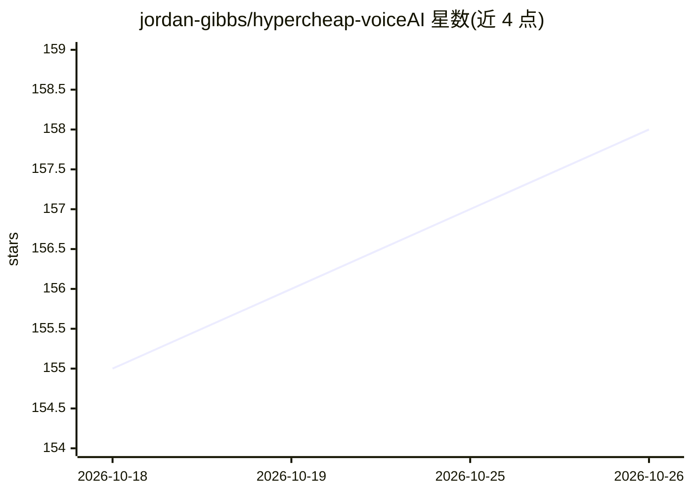

# jordan-gibbs/hypercheap-voiceAI

⭐ 158 · Python · MIT · 推送 2025-10-31 · [GitHub](https://github.com/jordan-gibbs/hypercheap-voiceAI) · 个人维护

**低成本实时语音 AI 对话代理：Fennec ASR + Baseten LLM + Inworld TTS**

开源的语音 AI agent 技术栈：Fennec 实时流式 ASR（含服务端 VAD 与即时打断）、Baseten 上通过 OpenAI 兼容 API 调用 Qwen3-235B LLM、Inworld 流式 TTS，端到端延迟 600-800ms，标称每小时总成本约 $0.25-0.35。面向开发者自部署：需注册三个服务并配置 API key，后端 FastAPI/uvicorn，前端 Vite（npm），提供可选 Docker 构建。默认 VAD 较激进，可能截断语速慢的说话者。

## 筛选速览

| 维度 | 判定 | 备注 |
|---|---|---|
| AI 角色 | `ai-native` | 本体是模型或模型工具 |
| 许可风险 | `permissive` | MIT |
| 部署形态 | `self-host` | docker 或自建部署 |
| 模型依赖 | — | README 未给出锁定关系 |
| 硬件要求 | — | 无带数字的原话,不猜 |
| 安装摩擦 | `low` | 无编译、无系统依赖或容器化 |
| 成熟度 | — | 结构信号不足 |

## 能力要点

- Fennec 实时 ASR + 服务端 VAD 与即时打断
- Baseten OpenAI 兼容端点调用 Qwen3-235B-A22B
- Inworld 流式 TTS，支持换音色与语音克隆
- README 给出逐项成本测算（约 $0.28/小时）

## 适用场景

- 自部署一个低成本的实时语音对话 agent
- 搭建可打断、低延迟的语音助手原型
- 按 env 变量替换 LLM/音色调整成本与效果

## 场景标签

`语音 Agent` · 领域:对话与助手

## 证据(README 行号)

> L10: - Full server VAD controls thanks to Fennec-ASR with instant barge-in capability
> L18: > **Stack:** Fennec (Realtime ASR) → Baseten (LLM via OpenAI-compatible API) → Inworld (streamed TTS)

## 星数曲线

2026-10-18 155 → 2026-10-26 158（+3）

---
*卡片 v1 · prompt 1.4 · 生成 2026-10-22 · 置信度 mid · 依据 README sha `6480838f12dd` · [字段定义](../../DATASET.md)*
