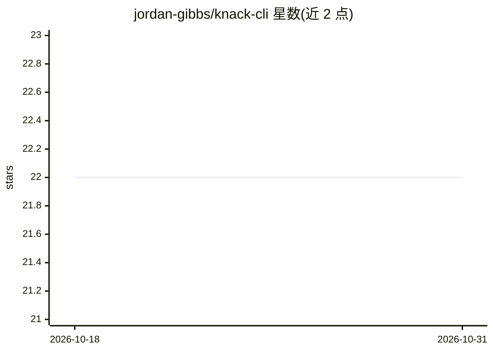

# jordan-gibbs/knack-cli

⭐ 22 · Rust · MIT · 推送 2026-07-27 · [GitHub](https://github.com/jordan-gibbs/knack-cli) · [官网](https://getknack.ai) · 个人维护

**面向 agent 的技能创作/版本管理/运行观测 CLI**

Knack 是一个用 Rust 编写的命令行工具，用于对 agent 技能（SKILL.md 格式，兼容 Anthropic 开放 Skills 规范）进行脚手架生成、本地校验、版本化发布、运行记录与结果标注。技能以结构化文件夹（指令、示例、测试、元数据）存放在 GitHub 私有仓库（自托管模式，依赖 git 与 GitHub CLI）或 Knack Cloud（含团队/市场功能）。每次运行写入 JSONL 遥测并可批量推送，支持把已发布技能安装为 Claude Code、Codex 等本地 agent 的斜杠命令，且版本锁定不自动更新。通过 curl/PowerShell 脚本安装二进制。

## 筛选速览

| 维度 | 判定 | 备注 |
|---|---|---|
| AI 角色 | `ai-ecosystem` | LLM/agent 周边工具 |
| 许可风险 | `permissive` | MIT |
| 部署形态 | `None` |  |
| 模型依赖 | — | README 未给出锁定关系 |
| 硬件要求 | — | 无带数字的原话,不猜 |
| 安装摩擦 | `low` | 无编译、无系统依赖或容器化 |
| 成熟度 | — | 结构信号不足 |

## 能力要点

- 技能全生命周期：create/validate/publish（git tag 不可变版本）/run/mark 迭代闭环
- 自托管模式仅依赖 GitHub 仓库，遥测以批量 JSONL commit 记录
- knack link 把技能装为多 agent 的原生斜杠命令并版本锁定
- 兼容 Anthropic 开放 Skills 格式，可跨 agent 提供方移植

## 适用场景

- 把散落的 SKILL.md 管理成带版本与测试的技能仓库
- 为 Claude Code/Codex 等本机 agent 统一安装和更新团队技能
- 记录每次技能运行的结果与反馈，用版本对比观测技能改进效果

## 场景标签

`Agent 框架` · 领域:Agent 开发

## 证据(README 行号)

> L5: An agent-driven CLI for authoring, validating, versioning, running, and observing agent skills.
> L98: `knack link <slug>` installs a published skill into every agent on your

## 星数曲线

2026-10-18 22 → 2026-10-31 22（+0）

---
*卡片 v1 · prompt 1.4 · 生成 2026-10-27 · 置信度 high · 依据 README sha `8281380a0a06` · [字段定义](../../DATASET.md)*
