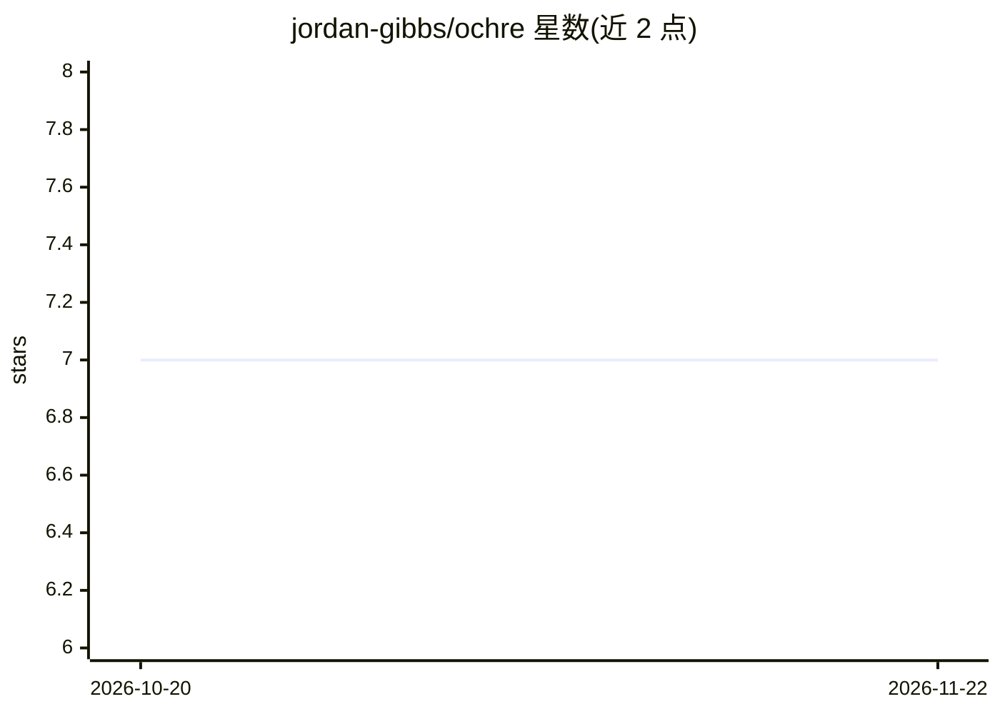

# jordan-gibbs/ochre

⭐ 7 · Rust · MIT · 推送 2026-11-04 · [GitHub](https://github.com/jordan-gibbs/ochre) · 个人维护

**开源跨平台语音听写工具：本地转写+AI润色+免提唤醒**

基于 Rust/Tauri 的桌面语音听写应用，按住按键说话，润色后的文本以原生按键方式输入到当前焦点文本框。默认在本机运行 NVIDIA Parakeet 语音识别（ONNX Runtime，25 种欧洲语言），可选 BYOK 接入 OpenAI、Google、Groq 等云服务；清洗步骤去除口头语、应用自我修正、修正标点，本地模型为自训练的 Ochre Refine 4B/2B/0.8B（Apache-2.0）。支持双击锁定、"transcribe" 唤醒词免提输入、本地历史。无遥测，音频不落盘，API key 存于系统钥匙串。

## 筛选速览

| 维度 | 判定 | 备注 |
|---|---|---|
| AI 角色 | `ai-native` | 本体是模型或模型工具 |
| 许可风险 | `permissive` | MIT |
| 部署形态 | `desktop` | 安装包/桌面程序 |
| 模型依赖 | — | README 未给出锁定关系 |
| 硬件要求 | — | 无带数字的原话,不猜 |
| 安装摩擦 | `low` | 无编译、无系统依赖或容器化 |
| 成熟度 | `idea` | |

## 能力要点

- 本地 Parakeet TDT 0.6B 转写，约 150 ms 延迟（CPU，基准测试环境 Ryzen 7 9800X3D）
- 可选 AI 清洗：本地 Ochre Refine 4B/2B/0.8B 或云 LLM（OpenAI/Google/Groq/OpenRouter/Anthropic）
- "transcribe" 唤醒词免提听写，仓库内训练的自定义唤醒词模型
- BYOK 连接器：粘贴 API key 即用云语音转写，成本按小时计

## 适用场景

- 在任意应用的输入框中按住按键口述并自动润色文本
- 双手离开键盘时用唤醒词免提口述并发送
- 不想订阅商业听写服务，本地运行语音转写

## 场景标签

`语音识别` · 领域:感知与多模态

## 证据(README 行号)

> L11: Ochre is a free alternative to subscription dictation apps. Speech recognition runs
> L22: - **Accurate locally.** NVIDIA Parakeet TDT 0.6B (v3 "Ultra", int8) runs on ONNX Runtime and
> L33: - **Optional cleanup.** Local or cloud (OpenAI, Google, Groq, OpenRouter, Anthropic). Locally it

## 星数曲线

2026-10-20 7 → 2026-11-22 7（+0）

---
*卡片 v1 · prompt 1.4 · 生成 2026-11-20 · 置信度 high · 依据 README sha `e0cd933843c5` · [字段定义](../../DATASET.md)*
