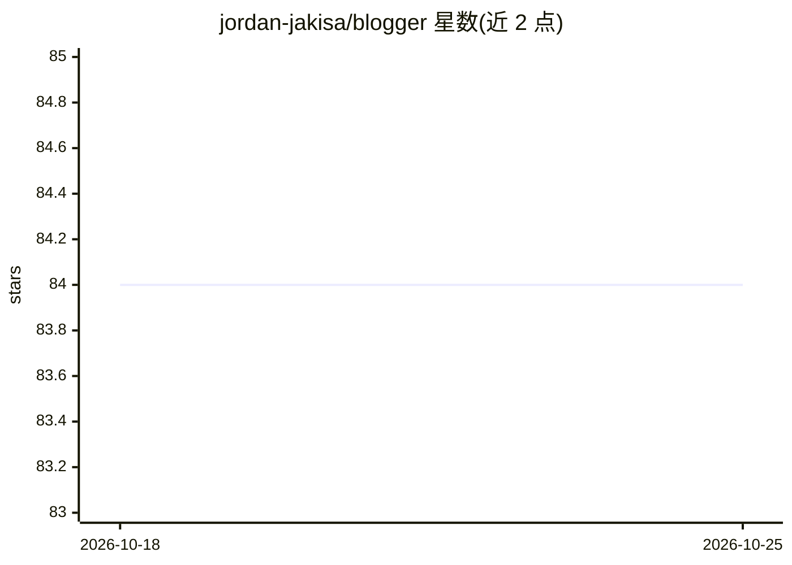

# jordan-jakisa/blogger

⭐ 84 · Python · MIT · 推送 2026-06-16 · [GitHub](https://github.com/jordan-jakisa/blogger) · [官网](https://ai-blog-post-generator.streamlit.app/) · 个人维护

**基于搜索与 LLM 自动生成 SEO 博客文章的 agent 应用**

Python 脚本加 Streamlit 界面的博客写作 agent：按关键词调用 DuckDuckGo 搜索获取网页参考，用 DocumentLoader 抽取文本、切分后经 OpenAIEmbeddings 嵌入并存入 FAISS 向量库，检索相关片段作为提示输入 GPT 模型（经 LangChain/LangGraph 编排）生成 Markdown 博客文章。面向需要快速产出博文的用户，提供在线 Demo，也可本地 git clone 后用 pipenv 安装运行，使用需自备 OpenAI API key，参考网页上限 10 条。

## 筛选速览

| 维度 | 判定 | 备注 |
|---|---|---|
| AI 角色 | `ai-native` | 本体是模型或模型工具 |
| 许可风险 | `permissive` | MIT |
| 部署形态 | `library` | 以包/库形式分发 |
| 模型依赖 | — | README 未给出锁定关系 |
| 硬件要求 | — | 无带数字的原话,不猜 |
| 安装摩擦 | `low` | 无编译、无系统依赖或容器化 |
| 成熟度 | — | 结构信号不足 |

## 能力要点

- 按关键词抓取 DuckDuckGo 搜索结果并抽取网页文本
- 文档切分 + OpenAIEmbeddings + 向量库存储与检索
- 经 LangChain/LangGraph 调用 GPT 模型生成博客文章
- 提供 Streamlit 在线 Demo 与本地运行方式

## 适用场景

- 输入关键词快速生成一篇有网络参考的博客文章
- 内容创作者按指定关键词批量起草博文初稿
- 在本地部署该工具并使用自己的 OpenAI key

## 场景标签

`AI 写作` `网页抓取` · 领域:效率与自动化

## 证据(README 行号)

> L7: The blog post creator agent is a python script that uses the DuckDuckGo Search API and OpenAI's GPT models (via Lang
> L37: 5. **Blog generation**: To generate the blog post, we shall pass the retrieved document chunks and the user keyword

## 星数曲线

2026-10-18 84 → 2026-10-25 84（+0）

---
*卡片 v1 · prompt 1.4 · 生成 2026-10-24 · 置信度 mid · 依据 README sha `f918fd557db1` · [字段定义](../../DATASET.md)*
