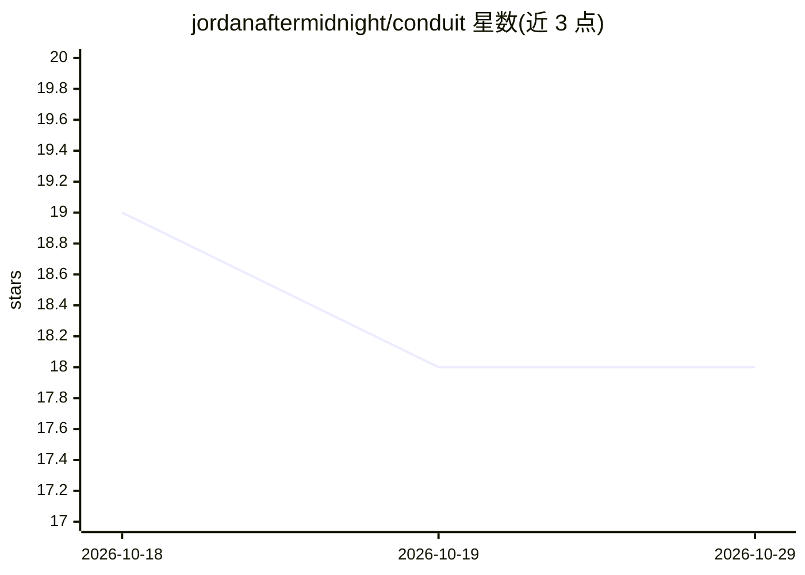

# jordanaftermidnight/conduit

⭐ 18 · Python · MIT · 推送 2026-08-20 · [GitHub](https://github.com/jordanaftermidnight/conduit) · 个人维护

**Max for Live 设备：用本地 LLM 在 Ableton 中生成 MIDI**

面向 Ableton Live 11/12 用户的 Max for Live 设备，通过本机运行的 Ollama（默认 llama3.2 3B）将文本提示转换为写入选定音轨的 MIDI 剪辑，覆盖鼓、旋律、贝斯与和弦进行；提供 Chat 模式可结合 BPM、拍号、轨道名等会话上下文对话。内置 8 种风格模块、模式剪贴板（每会话最多 20 个）与撤销功能，默认离线本地运行，可选接入 Anthropic/OpenAI 云端服务。macOS（Apple Silicon/Intel）与 Windows 提供双击安装脚本，需 Python 3.9+ 与约 4GB 空闲内存。

## 筛选速览

| 维度 | 判定 | 备注 |
|---|---|---|
| AI 角色 | `ai-native` | 本体是模型或模型工具 |
| 许可风险 | `permissive` | MIT |
| 部署形态 | `None` |  |
| 模型依赖 | local-ok | 支持本地模型 |
| 硬件要求 | — | 无带数字的原话,不猜 |
| 安装摩擦 | `low` | 无编译、无系统依赖或容器化 |
| 成熟度 | — | 结构信号不足 |

## 能力要点

- 文本提示生成 MIDI 剪辑直接写入 Ableton 音轨
- 默认经 Ollama 本地运行 llama3.2，无需订阅、可离线
- 8 种内置风格模块影响节奏、力度与音符选择
- 每 5 秒轮询 Ableton 会话状态（BPM/拍号/轨道名）作为生成上下文

## 适用场景

- 在 Ableton 中用一句话生成指定风格的鼓点或旋律
- 结合当前工程上下文与 AI 讨论编曲想法
- 本地离线运行以保持创作内容私密

## 场景标签

 · 领域:音乐制作/AI 工具

## 证据(README 行号)

> L7: Conduit is a Max for Live device that connects Ableton Live to a local AI running on your own machine. Type a prompt
> L17: Tell the AI what you want and get MIDI clips written straight into your selected track. Drums, melodies, basslines,
> L29: **Local by default** — Runs on Ollama with llama3.2 (3B parameter model). No subscriptions required. Works offline 

## 星数曲线

2026-10-18 19 → 2026-10-29 18（-1）

---
*卡片 v1 · prompt 1.4 · 生成 2026-10-29 · 置信度 high · 依据 README sha `a8f33269382f` · [字段定义](../../DATASET.md)*
