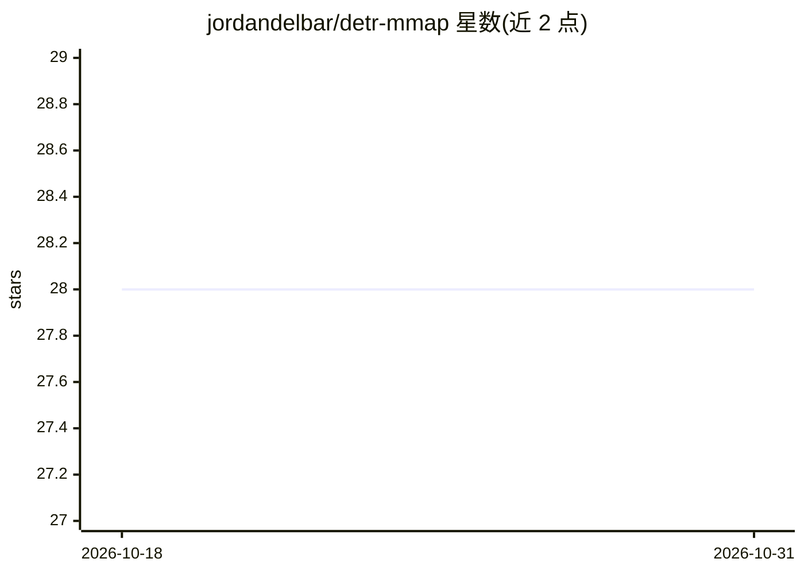

# jordandelbar/detr-mmap

⭐ 28 · Rust · Apache-2.0 · 推送 2026-02-05 · [GitHub](https://github.com/jordandelbar/detr-mmap) · 个人维护

**Rust 实现的 RF-DETR 边缘视频流目标检测管线**

以 Rust 编写的完整边缘 AI 管线：通过 v4l2 采集视频帧，运行 RF-DETR 目标检测（ONNX Runtime CPU/CUDA 或 CXX 集成的 TensorRT），并带哨兵模式状态机（检测到人切换 30 FPS 告警、无人回落 3 FPS 待机）。进程间通信用 mmap + FlatBuffers 零序列化共享内存，事件经 MQTT 发布，Axum WebSocket 向客户端推流；用 k3d 部署，OpenTelemetry+Jaeger 观测。给出推理/IPC 各环节延迟基准。面向边缘部署开发者。

## 筛选速览

| 维度 | 判定 | 备注 |
|---|---|---|
| AI 角色 | `ai-native` | 本体是模型或模型工具 |
| 许可风险 | `permissive` | Apache-2.0 |
| 部署形态 | `None` |  |
| 模型依赖 | — | README 未给出锁定关系 |
| 硬件要求 | — | 无带数字的原话,不猜 |
| 安装摩擦 | `medium` | 含编译或系统依赖之一 |
| 成熟度 | — | 结构信号不足 |

## 能力要点

- mmap + FlatBuffers 零序列化 IPC，读帧 48 ns 级
- 哨兵状态机（滞回）按人员检测结果切换 30/3 FPS 省算力
- ORT CPU/CUDA 与 TensorRT INT8 双推理后端，GPU 预处理自动启用
- GHCR 预构建镜像快速演示，支持 k3d GPU 部署

## 适用场景

- 边缘设备上做人流检测并联动 MQTT 告警
- 参考低延迟零拷贝 IPC 的视频管线架构
- 在 Jetson/树莓派等边缘硬件上部署检测服务

## 场景标签

`目标检测` · 领域:感知与多模态

## 证据(README 行号)

> L10: This project implements a complete edge AI pipeline with RF-DETR object detection, designed for minimal latency and
> L22:  - Inference: [RF-DETR] model inference:

## 星数曲线

2026-10-18 28 → 2026-10-31 28（+0）

---
*卡片 v1 · prompt 1.4 · 生成 2026-10-26 · 置信度 high · 依据 README sha `81cd64e9dc29` · [字段定义](../../DATASET.md)*
