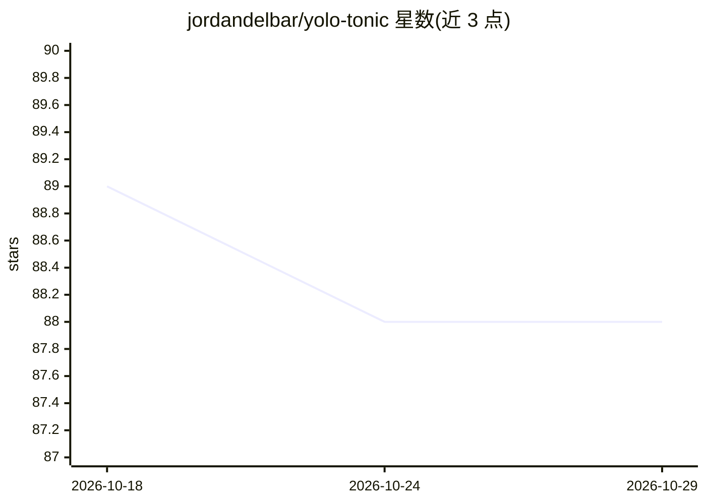

# jordandelbar/yolo-tonic

⭐ 88 · Rust · AGPL-3.0 · 推送 2025-12-16 · [GitHub](https://github.com/jordandelbar/yolo-tonic) · 个人维护

**Rust 实时 YOLOv8 摄像头目标检测流水线（gRPC + WebSocket）**

实时目标检测流水线：Tonic + Ort 构建的 Rust gRPC 服务负责 YOLOv8（ONNX）推理，Axum 中间件读取摄像头视频流（OpenCV 处理帧）、收集预测结果并经 WebSocket 推送，附带 HTML 页面实时可视化，另有 predict_image POST 端点对 JPEG 图片直接推理。提供 CUDA/TensorRT GPU 加速运行选项。README 给出性能数据：TensorRT 单帧约 40ms 中位延迟，CPU 约 72ms（RTX2060 / Ryzen 7 9800x3D 测试）。仅支持 Linux（依赖挂载 /dev/video0）。代码以 AGPLv3 授权，声明仅供教育演示用途。

## 筛选速览

| 维度 | 判定 | 备注 |
|---|---|---|
| AI 角色 | `ai-native` | 本体是模型或模型工具 |
| 许可风险 | `viral` | AGPL-3.0 |
| 部署形态 | `None` |  |
| 模型依赖 | — | README 未给出锁定关系 |
| 硬件要求 | — | 无带数字的原话,不猜 |
| 安装摩擦 | `medium` | 含编译或系统依赖之一 |
| 成熟度 | — | 结构信号不足 |

## 能力要点

- Tonic/Ort gRPC 服务运行 YOLOv8 ONNX 推理，Axum + WebSocket 推送检测结果
- 支持 CUDA/TensorRT GPU 加速与 CPU 两种运行方式
- predict_image POST 端点支持对 JPEG 图片直接推理
- 并行推理会话设计，TensorRT 单帧中位延迟约 40ms

## 适用场景

- 在网页上实时查看摄像头画面的目标检测结果
- 对 JPEG 图片执行 YOLOv8 目标检测
- 学习 gRPC 推理服务与视频流中间件的架构组合

## 场景标签

`目标检测` · 领域:感知与多模态

## 证据(README 行号)

> L5: This project implements a real-time object detection pipeline using a YOLO v8 model. A Rust-based gRPC service (usin
> L11:  - [Tonic], [Ort] for running YOLO model inference via gRPC using [ONNX] runtime

## 星数曲线

2026-10-18 89 → 2026-10-29 88（-1）

---
*卡片 v1 · prompt 1.4 · 生成 2026-10-23 · 置信度 high · 依据 README sha `3143c9594f3a` · [字段定义](../../DATASET.md)*
