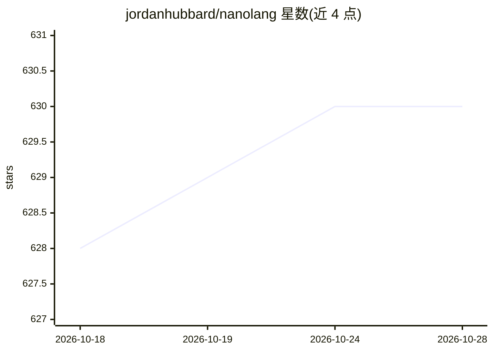

# jordanhubbard/nanolang

⭐ 630 · C · Apache-2.0 · 推送 2026-10-27 · [GitHub](https://github.com/jordanhubbard/nanolang) · 个人维护

**面向编码 LLM 设计的实验编程语言与安全运行时**

一门设计为『机器编写、人类阅读』的小型编程语言，配套 NanoISA 验证字节码虚拟机（161 个操作码、FFI 隔离在协同进程）、可转译为 C 的编译器、LSP/DAP 与 VS Code 扩展、浏览器 Playground。核心语义在 Coq 中机械证明（类型可靠性、确定性、大小步等价），提供能力、版本化服务契约与 POSIX 服务构造。面向编码 LLM 与语言设计/形式化验证方向的开发者；v5.1 路线图（如 NanoISA-only 编译）未完成。

## 筛选速览

| 维度 | 判定 | 备注 |
|---|---|---|
| AI 角色 | `ai-ecosystem` | LLM/agent 周边工具 |
| 许可风险 | `permissive` | Apache-2.0 |
| 部署形态 | `None` |  |
| 模型依赖 | — | README 未给出锁定关系 |
| 硬件要求 | — | 无带数字的原话,不猜 |
| 安装摩擦 | `low` | 无编译、无系统依赖或容器化 |
| 成熟度 | `idea` | |

## 能力要点

- 核心语义在 Coq 中机械证明且无 Axiom/Admitted
- NanoISA 字节码 VM：运行前验证、FFI 协同进程隔离、守护进程模式
- 转译到 C 的原生路径与 profile-guided 内联优化
- 自带 LSP、DAP 调试器、VS Code 扩展与 Web Playground

## 适用场景

- 让编码 LLM 生成语法无歧义、可测试验证的程序
- 研究面向 AI 的语言设计与形式化语义
- 在最小权限运行时中托管服务

## 场景标签

 · 领域:编程语言/编译器

## 证据(README 行号)

> L7: **I am a programming language designed for machines to write and humans to read, and a secure runtime that hosts lea
> L203: I was designed to be written by machines.

## 星数曲线

2026-10-18 628 → 2026-10-28 630（+2）

---
*卡片 v1 · prompt 1.4 · 生成 2026-10-22 · 置信度 high · 依据 README sha `691445b223f0` · [字段定义](../../DATASET.md)*
