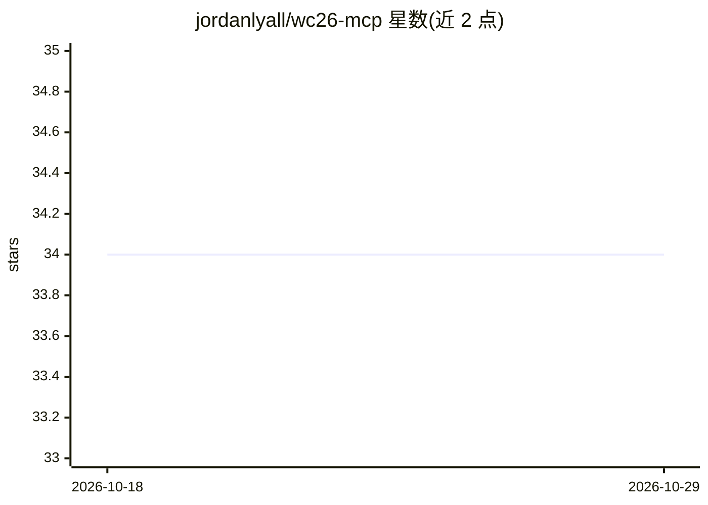

# jordanlyall/wc26-mcp

⭐ 34 · TypeScript · MIT · 推送 2026-10-28 · [GitHub](https://github.com/jordanlyall/wc26-mcp) · [官网](https://wc26.ai) · 个人维护

**2026 世界杯数据的 MCP 服务器：18 个查询工具供 AI 客户端调用**

以 TypeScript 编写的 Model Context Protocol 服务器，内置 2026 年世界杯全部数据（104 场比赛、48 支球队、16 座场馆、城市指南、签证信息、历史交锋等），通过 18 个工具经 stdio 供 Claude Desktop、Claude Code、Cursor、Windsurf、ChatGPT 等客户端调用；另提供 ChatGPT GPT 与 Telegram Bot（17 个斜杠命令）两种免安装入口。数据随包分发，无需 API key 与外部依赖。npx 即可运行。

## 筛选速览

| 维度 | 判定 | 备注 |
|---|---|---|
| AI 角色 | `ai-ecosystem` | LLM/agent 周边工具 |
| 许可风险 | `permissive` | MIT |
| 部署形态 | `library` | 以包/库形式分发 |
| 模型依赖 | locked-api |  |
| 硬件要求 | — | 无带数字的原话,不猜 |
| 安装摩擦 | `low` | 无编译、无系统依赖或容器化 |
| 成熟度 | — | 结构信号不足 |

## 能力要点

- 18 个工具覆盖赛程、球队、场馆、城市指南、签证、伤病、赔率、淘汰赛对阵等
- 数据全部随包内置，零 API key、零外部依赖
- 支持 Claude Desktop/Code、Cursor、Windsurf、ChatGPT 及任意 MCP 客户端，另有 Telegram Bot 17 个命令
- 时间感知的 what_to_know_now 工具按赛事阶段返回当日简报

## 适用场景

- 在 Claude 或 Cursor 里直接询问世界杯赛程、球队与场馆信息
- 查询主办城市旅行指南、签证要求与球迷广场位置
- 通过 Telegram 机器人获取每日世界杯简报与新闻

## 场景标签

 · 领域:体育/数据服务

## 证据(README 行号)

> L10: Ask your AI anything about the 2026 World Cup and get real answers. 18 tools covering matches, teams, venues, city 
> L73: The server communicates over stdio using the Model Context Protocol:

## 星数曲线

2026-10-18 34 → 2026-10-29 34（+0）

---
*卡片 v1 · prompt 1.4 · 生成 2026-10-25 · 置信度 high · 依据 README sha `d1944764f888` · [字段定义](../../DATASET.md)*
