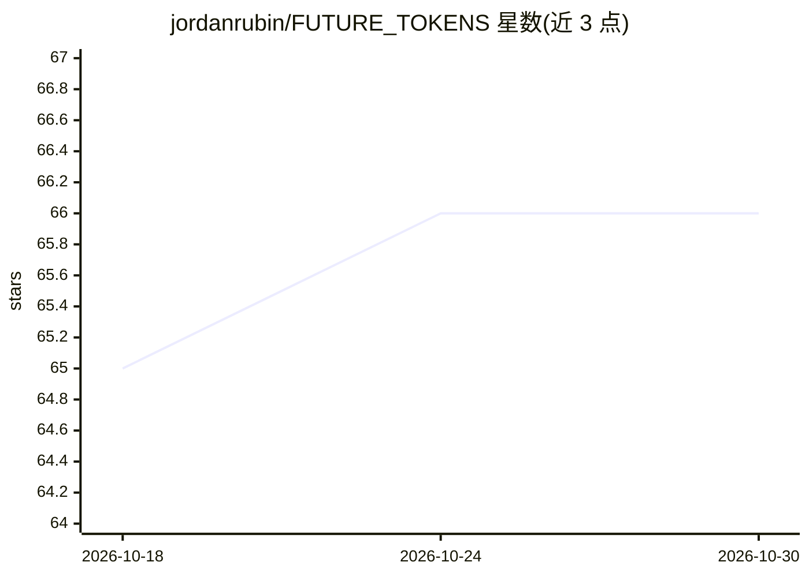

# jordanrubin/FUTURE_TOKENS

⭐ 66 · Shell · NOASSERTION · 推送 2026-02-19 · [GitHub](https://github.com/jordanrubin/FUTURE_TOKENS) · 个人维护

**面向 Claude 的可组合推理技能集：针对生成盲区的思维操作**

以 Claude Skills 技能集形式组织的推理操作库：提供 antithesize（对立面）、excavate（隐含假设）、dimensionalize（缺失维度）、negspace（显性缺席）、metaphorize 等多个命名的可组合技能，各自针对一类生成过程系统性遗漏的盲区类型。技能以 Markdown 过程定义加嵌入示例的形式存放，同一技能定义兼容 Codex 工作流。提供一键安装脚本、Claude Code 插件市场安装与 Claude.ai 手动上传三种安装方式；作者声明与 Anthropic 无关联。

## 筛选速览

| 维度 | 判定 | 备注 |
|---|---|---|
| AI 角色 | `ai-ecosystem` | LLM/agent 周边工具 |
| 许可风险 | `none` | NOASSERTION |
| 部署形态 | `None` |  |
| 模型依赖 | — | README 未给出锁定关系 |
| 硬件要求 | — | 无带数字的原话,不猜 |
| 安装摩擦 | `low` | 无编译、无系统依赖或容器化 |
| 成熟度 | — | 结构信号不足 |

## 能力要点

- 多个命名的可组合推理技能，各针对一类盲区类型（对立缺口、隐含假设、缺失维度等）
- SKILL.md 作为技能主索引与目录
- 同一技能定义兼容 Claude 与 Codex 工作流
- 提供一键脚本、插件市场、ZIP 上传三种安装途径

## 适用场景

- 为 Claude 或 Codex agent 添加结构化推理技能
- 在生成前引入对立面与缺失维度分析以覆盖盲区
- 按需组合 antithesize/synthesize 等操作构建推理流程

## 场景标签

`提示工程` · 领域:Agent 开发

## 证据(README 行号)

> L5: This repository is formatted as a Claude Skills skillset, and the same skill definitions are compatible with Codex w
> L62: Skills target different blind spot types: opposition gaps (antithesize), hidden assumptions (excavate), missing dim

## 星数曲线

2026-10-18 65 → 2026-10-30 66（+1）

---
*卡片 v1 · prompt 1.4 · 生成 2026-10-24 · 置信度 high · 依据 README sha `758f33e16fc0` · [字段定义](../../DATASET.md)*
