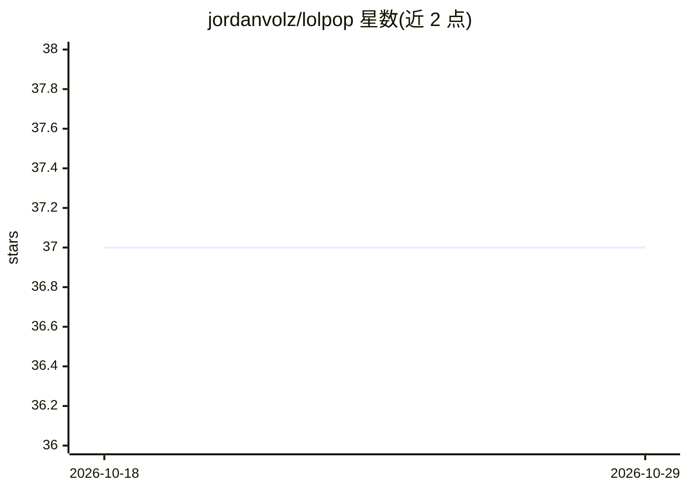

# jordanvolz/lolpop

⭐ 37 · Python · Apache-2.0 · 推送 2026-01-24 · [GitHub](https://github.com/jordanvolz/lolpop) · [官网](https://lolpop.readthedocs.io/) · 个人维护

**面向 ML 工作流的软件工程框架，统一数据科学与 ML 工程**

Python 编写的机器学习工作流框架，以 Components（外部库集成）、Pipelines（跨组件动作）、Runners（端到端协调）三层概念组织 ML 开发到生产流程。组件通过 YAML 配置声明式装配，可用 Python 代码或 lolpop CLI 调用工作流。定位为各类 ML 工具间的粘合层：不是编排器、管道工具或元数据追踪器，而是提供稳定 API 与可扩展机制，让既有工作负载以轻量重构方式接入。从 PyPI 安装。

## 筛选速览

| 维度 | 判定 | 备注 |
|---|---|---|
| AI 角色 | `ai-ecosystem` | LLM/agent 周边工具 |
| 许可风险 | `permissive` | Apache-2.0 |
| 部署形态 | `library` | 以包/库形式分发 |
| 模型依赖 | — | README 未给出锁定关系 |
| 硬件要求 | — | 无带数字的原话,不猜 |
| 安装摩擦 | `low` | 无编译、无系统依赖或容器化 |
| 成熟度 | — | 结构信号不足 |

## 能力要点

- Components/Pipelines/Runners 三层概念模型与层级结构
- YAML 配置声明式装配，支持 Python 代码与 CLI 两种调用方式
- 强调模块化、可扩展与低切换成本的设计原则
- 预置 runner/pipeline/component 集成与扩展框架

## 适用场景

- 搭建从训练到生产的标准化 ML 工作流
- 团队统一数据科学与 ML 工程的协作框架
- 以轻量重构方式将既有 ML 负载迁移到统一框架

## 场景标签

`MLOps` · 领域:训练与推理

## 证据(README 行号)

> L25: lolpop is a software engineering framework for machine learning workflows.
> L115: We've long felt that the ML ecosystem lacked a tool to act as the glue between all the various things that one nee

## 星数曲线

2026-10-18 37 → 2026-10-29 37（+0）

---
*卡片 v1 · prompt 1.4 · 生成 2026-10-25 · 置信度 high · 依据 README sha `183d2a0c2eac` · [字段定义](../../DATASET.md)*
