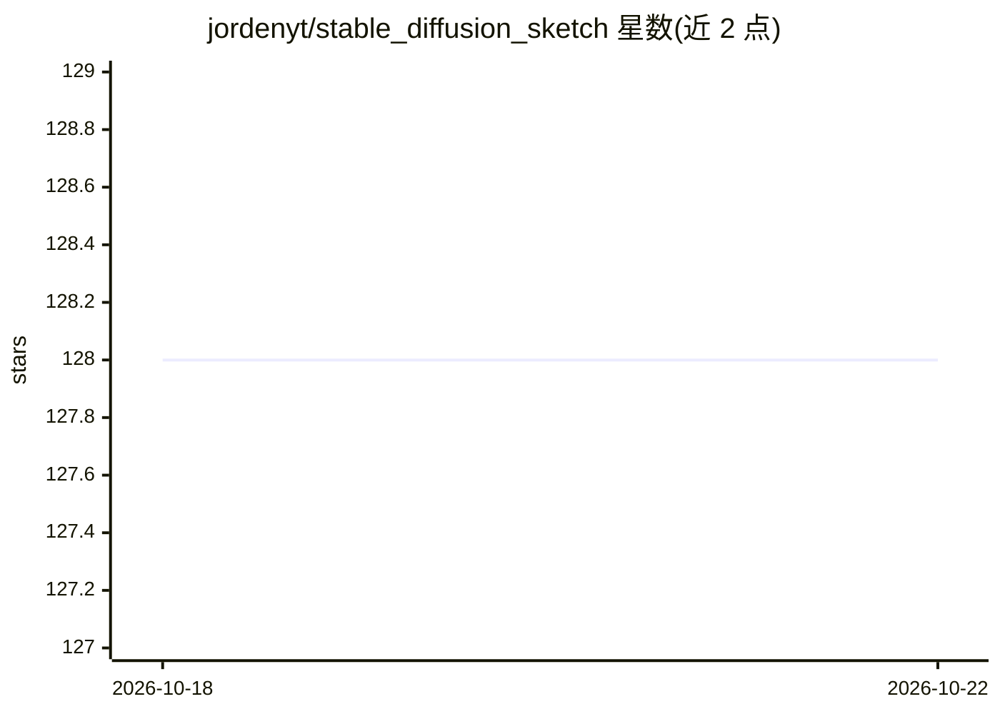

# jordenyt/stable_diffusion_sketch

⭐ 128 · Java · GPL-3.0 · 推送 2026-02-23 · [GitHub](https://github.com/jordenyt/stable_diffusion_sketch) · 个人维护

**Android 绘图客户端：连接自己的 ComfyUI 进行 AI 图像生成**

面向 Android 用户的草图/照片绘制与 AI 图像生成应用：通过 RESTful API 连接用户自建的 ComfyUI 服务器（需另行部署 ComfyuiGW API 网关），支持彩色素描、相机取图、放大、标注、批量处理等。生成参数支持五级配置（工作流 JSON、服务器、应用默认、模式、Prompt 内键值覆盖），可设置尺寸、CFG、步数、去噪强度等。APK 直接安装，另有 A1111 版本分支。

## 筛选速览

| 维度 | 判定 | 备注 |
|---|---|---|
| AI 角色 | `ai-native` | 本体是模型或模型工具 |
| 许可风险 | `viral` | GPL-3.0 |
| 部署形态 | `None` |  |
| 模型依赖 | — | README 未给出锁定关系 |
| 硬件要求 | — | 无带数字的原话,不猜 |
| 安装摩擦 | `low` | 无编译、无系统依赖或容器化 |
| 成熟度 | — | 结构信号不足 |

## 能力要点

- 通过 RESTful API 连接自建 ComfyUI 服务器
- 彩色素描、相机取图、放大、标注、批量处理等绘图工具
- 五级参数配置体系（工作流/服务器/应用/模式/Prompt）
- 4 种画布比例与设置导入导出

## 适用场景

- 在手机上绘制草图并交由自建 ComfyUI 生成图像
- 通过相机或其他应用图片作为输入进行 AI 变换
- 在移动端配置与管理生成参数（尺寸/CFG/步数等）

## 场景标签

`图像生成` · 领域:内容生成

## 证据(README 行号)

> L3: Transform your sketches and photos with Stable Diffusion on Android. This app integrates with ComfyUI via a RESTful 
> L11: - 🎨 **Sketch with color** using intuitive drawing tools
> L12: - ✨ **AI-powered enhancements** via ComfyUI workflows

## 星数曲线

2026-10-18 128 → 2026-10-22 128（+0）

---
*卡片 v1 · prompt 1.4 · 生成 2026-10-22 · 置信度 high · 依据 README sha `ad475471147d` · [字段定义](../../DATASET.md)*
