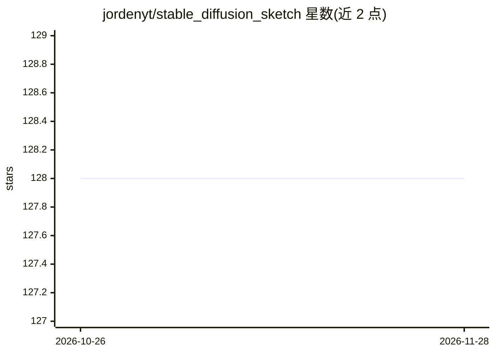

# jordenyt/stable_diffusion_sketch

⭐ 128 · Java · GPL-3.0 · 推送 2026-11-26 · [GitHub](https://github.com/jordenyt/stable_diffusion_sketch) · 个人维护

**安卓手绘草图客户端：连接自建 ComfyUI 生成 AI 图像**

面向 Android 的客户端应用，通过 ComfyUI Restful API Gateway（ComfyuiGW）与用户自建的 ComfyUI 服务器通信，应用本身不内嵌 Stable Diffusion 后端。提供画笔绘制、拍照/相册/分享四种图像输入方式，支持文生图、图生图、局部重绘、参考引导生成、放大与视频等由网关发布的工作流模式，另含 prompt 增写文本工作流。生成任务经网关提交、轮询进度并取回结果，EXIF 元数据写入导出 JPEG。前置条件为服务器上运行 ComfyUI 与 ComfyuiGW，设备需 Android 8.0+。

## 筛选速览

| 维度 | 判定 | 备注 |
|---|---|---|
| AI 角色 | `ai-native` | 本体是模型或模型工具 |
| 许可风险 | `viral` | GPL-3.0 |
| 部署形态 | `None` |  |
| 模型依赖 | — | README 未给出锁定关系 |
| 硬件要求 | — | 无带数字的原话,不猜 |
| 安装摩擦 | `low` | 无编译、无系统依赖或容器化 |
| 成熟度 | — | 结构信号不足 |

## 能力要点

- 通过 ComfyuiGW 网关调用任意已发布的 ComfyUI 工作流（txt2img/img2img/inpainting 等模式）
- 画笔绘图支持调色板、取色器、撤销/重做、缩放平移，可从画布/相机/相册/分享四种方式开始
- 生成参数支持工作流 JSON、服务器配置、应用默认值、模式 JSON、prompt 内联标签五级配置
- 前台通知显示节点进度与队列位置，导出 JPEG 写入 prompt/steps/相机等 EXIF 元数据

## 适用场景

- 在安卓平板/手机上手绘草图并用自建 ComfyUI 生图
- 通过局域网或路由器端口转发远程使用自己的 ComfyUI 服务器
- 按项目整理生成结果并保留完整参数元数据

## 场景标签

`图像生成` · 领域:内容生成

## 证据(README 行号)

> L3: Sketch on your Android phone and turn your drawing into an AI image. The app talks to ComfyUI through the ComfyUI Re
> L30: 1. ComfyUI running on a server
> L49: The app does not embed any Stable Diffusion backend. It picks a **mode** published by the gateway, fills the mode's

## 星数曲线

2026-10-26 128 → 2026-11-28 128（+0）

---
*卡片 v1 · prompt 1.4 · 生成 2026-11-28 · 置信度 high · 依据 README sha `ed429fa86977` · [字段定义](../../DATASET.md)*
