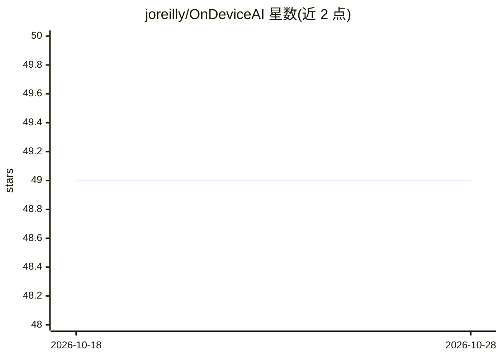

# joreilly/OnDeviceAI

⭐ 49 · Kotlin · 推送 2026-10-26 · [GitHub](https://github.com/joreilly/OnDeviceAI) · 个人维护

**演示 iOS/Android 端侧 AI 的 Compose Multiplatform 极简示例**

一个 Compose Multiplatform 示例工程，演示在 iOS 与 Android 上使用端侧 AI：iOS 侧调用 Foundation Model Framework（Swift 实现），Android 侧调用 MLKit Prompt API（Kotlin 实现），二者实现同一个 Kotlin `PromptApi` 接口，由共享 KMP 代码在 iOS 上调起 Swift 实现。工程分 composeApp/androidApp/iosApp 三个模块，模块拆分因 AGP 9 要求。作者自述实现通过顶层变量注入，属于简化写法。给 Kotlin 多平台开发者参考。

## 筛选速览

| 维度 | 判定 | 备注 |
|---|---|---|
| AI 角色 | `ai-native` | 本体是模型或模型工具 |
| 许可风险 | `none` | — |
| 部署形态 | `None` |  |
| 模型依赖 | — | README 未给出锁定关系 |
| 硬件要求 | — | 无带数字的原话,不猜 |
| 安装摩擦 | `low` | 无编译、无系统依赖或容器化 |
| 成熟度 | — | 结构信号不足 |

## 能力要点

- 统一 `PromptApi` 接口，iOS 用 Swift、Android 用 Kotlin 双实现
- iOS 调用 Foundation Model Framework，Android 调用 MLKit Prompt API
- composeApp/androidApp/iosApp 三模块结构（AGP 9 约束所致）

## 适用场景

- 参考如何在 KMP 共享代码中调用平台端侧 AI API
- 了解 AGP 9 下 KMP 应用的模块拆分方式

## 场景标签

`教程课程` · 领域:学习与行业

## 证据(README 行号)

> L3: Extremely minimal Compose Multiplatform sample that demonstrates use of on-device AI
> L4: on iOS and Android. Specifically it uses Foundation Model Framework on iOS and [MLKit

## 星数曲线

2026-10-18 49 → 2026-10-28 49（+0）

---
*卡片 v1 · prompt 1.4 · 生成 2026-10-24 · 置信度 high · 依据 README sha `9b5918d3faec` · [字段定义](../../DATASET.md)*
