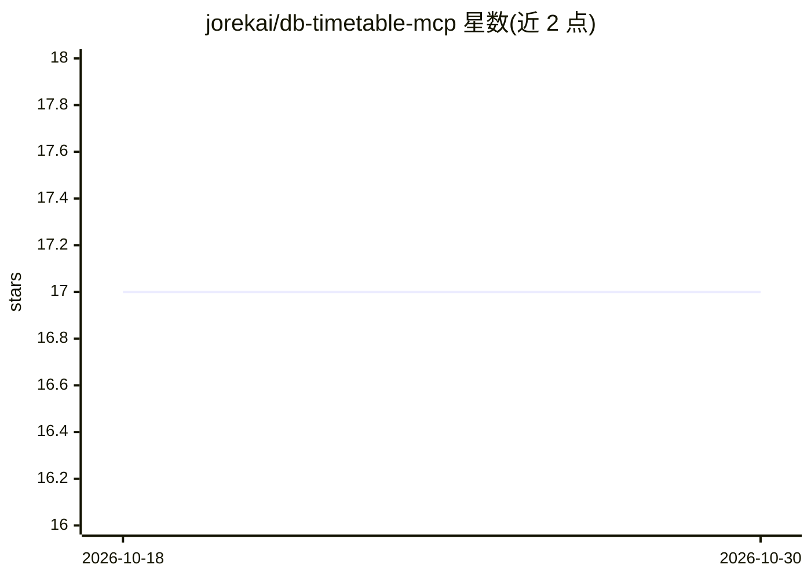

# jorekai/db-timetable-mcp

⭐ 17 · TypeScript · MIT · 推送 2026-10-17 · [GitHub](https://github.com/jorekai/db-timetable-mcp) · [官网](https://db-timetable-mcp-web.vercel.app/de) · 个人维护

**接入德铁时刻表 API 的 MCP 服务器，供 LLM 查询车站班次**

基于官方 TypeScript SDK 的 Model Context Protocol 服务器，读取 Deutsche Bahn Timetables API，将紧凑的 DB XML 转换为语义化 JSON，并把计划时刻表与实时变更合并为单一车站班次（planned/changed/effective 结构）。提供 getStationBoard、getPlannedTimetable、findStations 等 5 个工具，支持 stdio 本地与无状态 Streamable HTTP 远程两种传输，可经 Docker Compose 部署。使用需 Node.js 22/24 LTS 与 DB API Marketplace 订阅的 Timetables 产品凭证；文档当前为德语，数据需 CC BY 4.0 署名德铁。

## 筛选速览

| 维度 | 判定 | 备注 |
|---|---|---|
| AI 角色 | `ai-ecosystem` | LLM/agent 周边工具 |
| 许可风险 | `permissive` | MIT |
| 部署形态 | `self-host` | docker 或自建部署 |
| 模型依赖 | — | README 未给出锁定关系 |
| 硬件要求 | — | 无带数字的原话,不猜 |
| 安装摩擦 | `low` | 无编译、无系统依赖或容器化 |
| 成熟度 | — | 结构信号不足 |

## 能力要点

- 将 DB XML 转为语义化 JSON，合并计划与实时变更为 effective 车站班次
- 5 个工具含站名/EVA/DS100 检索与两分钟增量变更
- stdio 与无状态 Streamable HTTP 双传输，Docker Compose 部署（非 root、只读文件系统、回环绑定）
- 工具返回 structuredContent 与描述性 JSON schema，数据模型可作为 MCP resource 获取

## 适用场景

- 在 Claude Desktop 等 MCP 客户端中查询德铁车站的实时到发与站台
- 构建需要德国铁路时刻数据的旅行助手或 agent
- 通过 Streamable HTTP 远程部署为团队共享的时刻表服务

## 场景标签

 · 领域:公共交通数据/LLM 工具集成

## 证据(README 行号)

> L8: A Model Context Protocol server for the official Deutsche Bahn Timetables API. It converts the compact DB XML into s
> L14: - **MCP conformance.** Official TypeScript SDK, stdio for local clients, stateless Streamable HTTP for remote opera

## 星数曲线

2026-10-18 17 → 2026-10-30 17（+0）

---
*卡片 v1 · prompt 1.4 · 生成 2026-10-29 · 置信度 high · 依据 README sha `16c5ae6b1b6a` · [字段定义](../../DATASET.md)*
