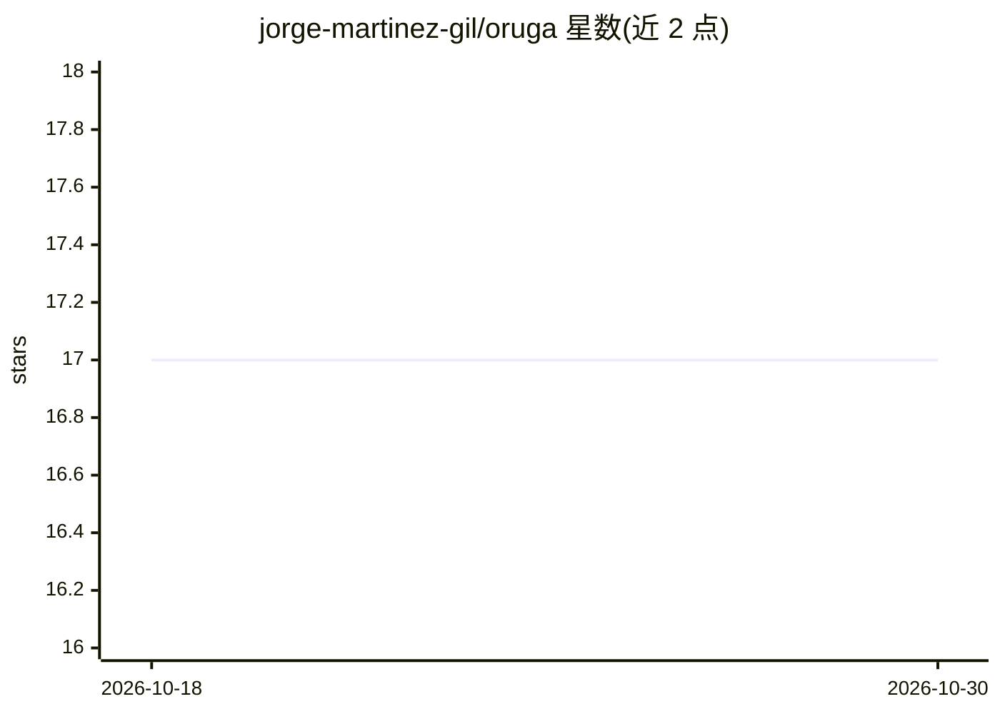

# jorge-martinez-gil/oruga

⭐ 17 · Python · MIT · 推送 2026-08-03 · [GitHub](https://github.com/jorge-martinez-gil/oruga) · [官网](https://www.sciencedirect.com/science/article/pii/S0950705123010225) · 个人维护

**面向研究者的 Python 文本可读性优化与简化评测框架**

ORUGA 是一个可引用的 Python 框架，通过遗传算法、群智能和多目标优化（含 Pareto 前沿）在保持语义的前提下降低文本阅读难度：同义词提供方提出替换候选，目标层用 FKGL、SMOG 等六种可读性指标打分，优化器搜索可读性、修改率与语义距离的折中。核心仅依赖 NumPy，WordNet/Word2Vec 等为可选扩展。同时作为统一评测层，可对规则系统、transformer 与 LLM 的简化输出打分。面向 NLP 研究者与开发者，附论文复现脚本与引用元数据，另有 Colab 演示与 CLI。

## 筛选速览

| 维度 | 判定 | 备注 |
|---|---|---|
| AI 角色 | `ai-native` | 本体是模型或模型工具 |
| 许可风险 | `permissive` | MIT |
| 部署形态 | `library` | 以包/库形式分发 |
| 模型依赖 | — | README 未给出锁定关系 |
| 硬件要求 | — | 无带数字的原话,不猜 |
| 安装摩擦 | `low` | 无编译、无系统依赖或容器化 |
| 成熟度 | — | 结构信号不足 |

## 能力要点

- 6 种可读性指标（FKGL/SMOG/Coleman-Liau/ARI/Flesch/Gunning Fog）
- 9 种优化器（GA/Jaya/布谷鸟/NSGA2 等）含 Pareto 前沿支持
- 核心仅依赖 NumPy，同义词提供方与优化后端为可选 extras
- 可对规则系统、transformer、LLM 的简化输出做统一评测

## 适用场景

- 我在做文本简化研究，需要一个可复现的演化计算 baseline
- 我想在保持语义的前提下降低文档的阅读难度等级
- 我想用同一套指标评测不同文本简化系统的输出

## 场景标签

`模型评测` `AI 写作` · 领域:评测与运维

## 证据(README 行号)

> L19: ORUGA is a citable Python framework for **semantics-preserving readability
> L86: ORUGA models simplification as a combinatorial search problem. A provider
> L95: |Objective|Readability, modification rate, Jaccard distance, or Word Mover's Distance|

## 星数曲线

2026-10-18 17 → 2026-10-30 17（+0）

---
*卡片 v1 · prompt 1.4 · 生成 2026-10-29 · 置信度 high · 依据 README sha `4272c5944d90` · [字段定义](../../DATASET.md)*
