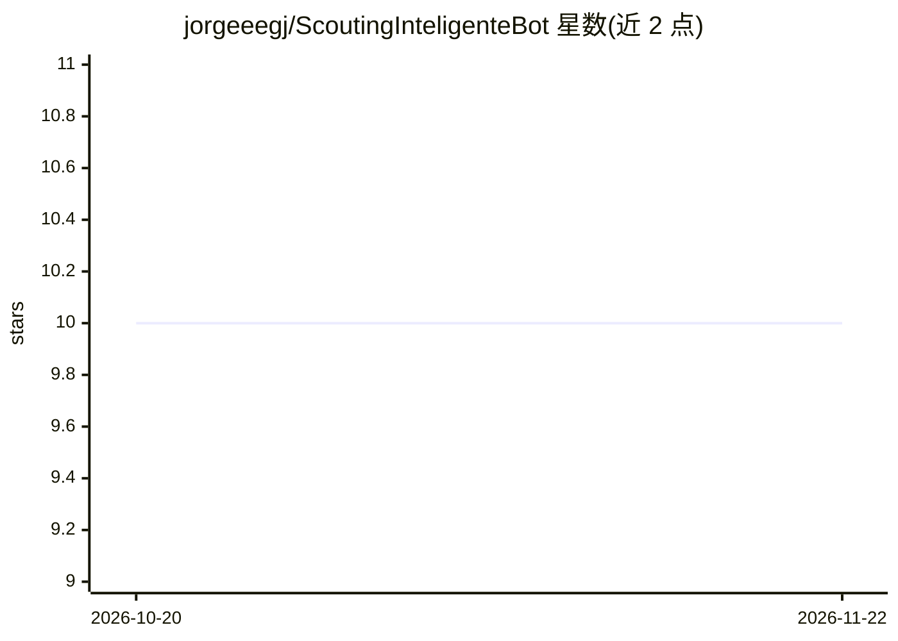

# jorgeeegj/ScoutingInteligenteBot

⭐ 10 · Python · MIT · 推送 2026-06-01 · [GitHub](https://github.com/jorgeeegj/ScoutingInteligenteBot) · 个人维护

**足球球探的多智能体 RAG 球员检索与解读 Telegram 机器人**

面向足球球探的端到端检索-过滤-打分-解读-可视化系统：用 FAISS 与多语言嵌入检索候选球员池，按年龄、位置、身价等硬性条件确定性过滤，基于百分位、出场时间与联赛系数的统计逻辑打分排序，LLM 仅负责生成 Top-3 的自然语言解读报告与雷达图，结果通过 Telegram 机器人交付。此仓库为不含数据的公开展示版，用户须自备授权数据并生成兼容的数据库与 FAISS 索引方可端到端运行，LLM 解释依赖 OpenAI API。

## 筛选速览

| 维度 | 判定 | 备注 |
|---|---|---|
| AI 角色 | `ai-native` | 本体是模型或模型工具 |
| 许可风险 | `permissive` | MIT |
| 部署形态 | `self-host` | docker 或自建部署 |
| 模型依赖 | — | README 未给出锁定关系 |
| 硬件要求 | — | 无带数字的原话,不猜 |
| 安装摩擦 | `low` | 无编译、无系统依赖或容器化 |
| 成熟度 | — | 结构信号不足 |

## 能力要点

- FAISS 多语言嵌入检索 + 确定性硬过滤的球探查询流水线（LangGraph 编排 5 个 agent）
- 排序由统计打分层决定，LLM 仅生成解释不参与排名
- 自动生成对比雷达图与球员画像图并通过 Telegram 返回
- 附 ETL 参考实现：采集、身份匹配、向量化索引流程

## 适用场景

- 用自然语言按多个硬性条件筛选 U23 球员候选名单
- 为球探报告自动生成 Top-3 球员的解读与雷达对比图
- 参照其 ETL 模块搭建自有球员数据的向量化检索系统

## 场景标签

`多智能体` `RAG` `语义搜索` · 领域:Agent 开发

## 证据(README 行号)

> L5: ScoutingInteligenteBot is an end-to-end AI system for football scouting. It combines vector retrieval, deterministic
> L53: The ranking is produced by deterministic scoring logic. The LLM is used for explanation, not for deciding the final
> L29: The original system was developed and validated on a private local snapshot of **14,508 players** as of **2026-04-0

## 星数曲线

2026-10-20 10 → 2026-11-22 10（+0）

---
*卡片 v1 · prompt 1.4 · 生成 2026-11-19 · 置信度 high · 依据 README sha `d92c203d3ffe` · [字段定义](../../DATASET.md)*
