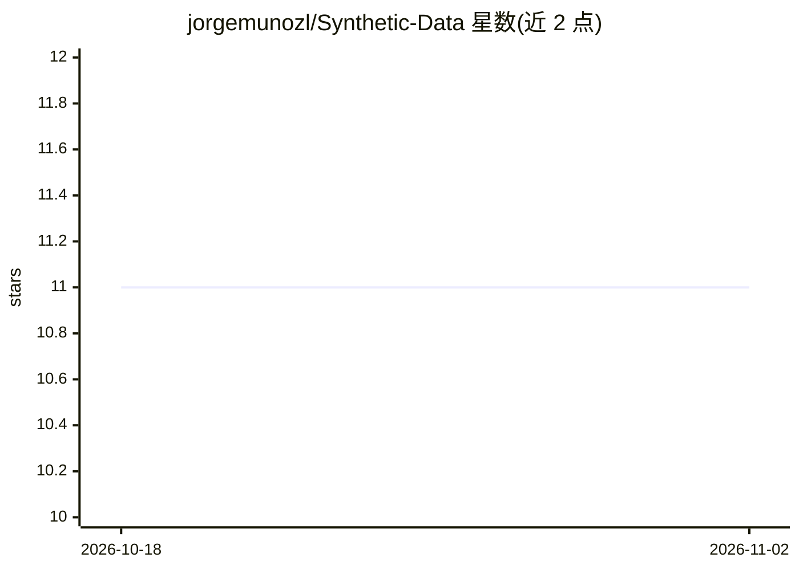

# jorgemunozl/Synthetic-Data

⭐ 11 · Python · 推送 2026-03-06 · [GitHub](https://github.com/jorgemunozl/Synthetic-Data) · [官网](https://jorgemunozl.github.io) · 个人维护

**生成 Mermaid 流程图合成数据集的 FastAPI 服务，用 LangGraph 编排**

基于 FastAPI 的服务，通过 LangGraph 多节点工作流（Planner、评估表、Generator、Reflector、Router）调用 OpenAI 模型（默认 gpt-4o、o4-mini）批量生成流程图：先规划主题指令，再产出 Mermaid 语法，对图表打分并在未达标时循环修订，最终经 Kroki API 渲染为 PNG，打包为 zip 供下载。需 OpenAI API key、Python 3.12+ 与 curl，支持 Docker 运行。限制：请求中的自由 prompt 列表当前被忽略，实际按配置文件中的主题与难度迭代。

## 筛选速览

| 维度 | 判定 | 备注 |
|---|---|---|
| AI 角色 | `ai-native` | 本体是模型或模型工具 |
| 许可风险 | `none` | — |
| 部署形态 | `self-host` | docker 或自建部署 |
| 模型依赖 | — | README 未给出锁定关系 |
| 硬件要求 | — | 无带数字的原话,不猜 |
| 安装摩擦 | `low` | 无编译、无系统依赖或容器化 |
| 成熟度 | — | 结构信号不足 |

## 能力要点

- 多节点 LangGraph 流水线：规划→生成→评审→路由循环
- 导出 Mermaid 源码与 PNG 图片并打包为 zip 下载
- 主题、难度与 LLM 模型可通过配置文件调整
- 提供 Dockerfile 与 docker-compose 部署方式

## 适用场景

- 为 LLM 微调或评测批量生成流程图合成数据
- 按主题与难度梯度批量产出 Mermaid 图与渲染图
- 作为可配置的流程图生成 API 服务部署

## 场景标签

 · 领域:合成数据/图表生成

## 证据(README 行号)

> L3: A FastAPI service that orchestrates a LangGraph workflow to generate Mermaid flowcharts with the help of OpenAI mode
> L8: - Multi-node LangGraph pipeline that plans, generates, critiques, and routes flowchart creation (`src/nodes.py`).
> L16: 3. **Generator**: produces Mermaid syntax from the planner guidance.

## 星数曲线

2026-10-18 11 → 2026-11-02 11（+0）

---
*卡片 v1 · prompt 1.4 · 生成 2026-11-02 · 置信度 high · 依据 README sha `27184bed4c2a` · [字段定义](../../DATASET.md)*
