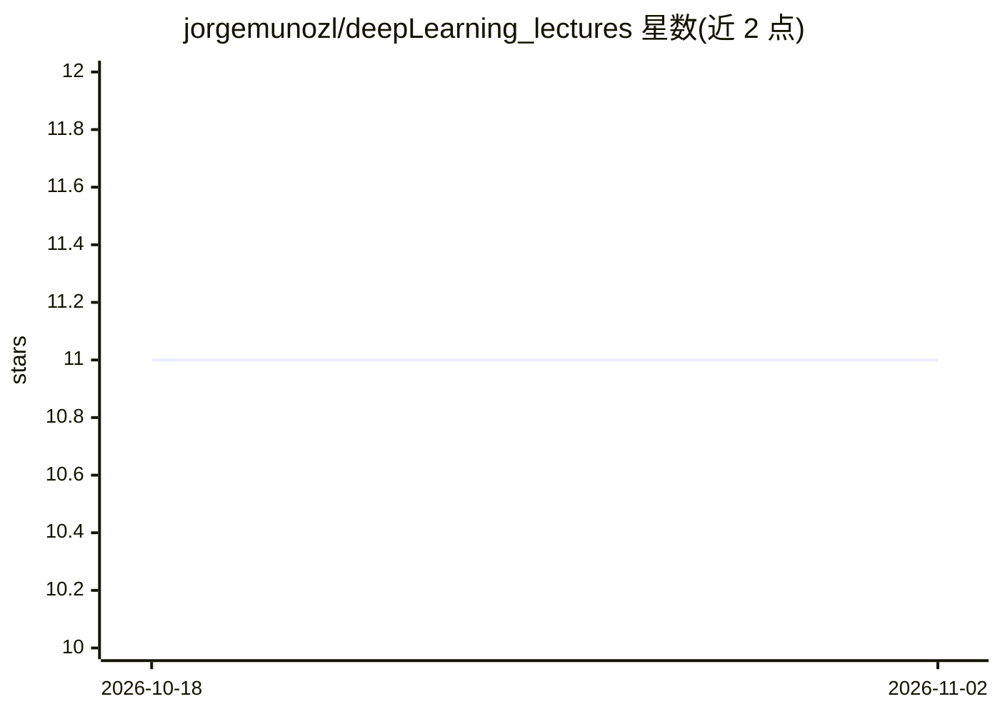

# jorgemunozl/deepLearning_lectures

⭐ 11 · Jupyter Notebook · 推送 2026-03-14 · [GitHub](https://github.com/jorgemunozl/deepLearning_lectures) · 个人维护

**深度学习教学 notebook 合集：从基础到前沿架构**

教育性质的深度学习 Jupyter notebook 集合，每个模块自包含，用原生 PyTorch 通过代码、数学与可视化讲解原理，不依赖封装库。内容涵盖 Vision Transformer（patch embedding、多头自注意力、CIFAR-10 训练与注意力可视化）与 Gemma 2B 的 LLM 推理（加载模型、在给定 prompt 上观察生成行为）。安装要求 Python ≥ 3.13，使用 uv sync 配置环境，MIT 许可。

## 筛选速览

| 维度 | 判定 | 备注 |
|---|---|---|
| AI 角色 | `ai-knowledge` | 知识聚合/清单类 |
| 许可风险 | `none` | — |
| 部署形态 | `None` |  |
| 模型依赖 | — | README 未给出锁定关系 |
| 硬件要求 | — | 无带数字的原话,不猜 |
| 安装摩擦 | `low` | 无编译、无系统依赖或容器化 |
| 成熟度 | — | 结构信号不足 |

## 能力要点

- 自包含模块式 Jupyter notebook，原生 PyTorch 实现
- ViT 模块覆盖 patch embedding、多头自注意力与 CIFAR-10 训练可视化
- Gemma 2B 推理模块：加载与运行推理

## 适用场景

- 通过代码与可视化从零理解 Transformer/ViT 机制
- 上手 PyTorch 深度学习实践
- 观察小型 LLM 的生成行为

## 场景标签

`教程课程` · 领域:学习与行业

## 证据(README 行号)

> L3: Educational deep learning notebooks — from first principles to frontier architectures.
> L5: Each module is a self-contained Jupyter notebook that builds intuition through code, math, and visualizations. No wr

## 星数曲线

2026-10-18 11 → 2026-11-02 11（+0）

---
*卡片 v1 · prompt 1.4 · 生成 2026-11-02 · 置信度 high · 依据 README sha `b25e6eb5273c` · [字段定义](../../DATASET.md)*
