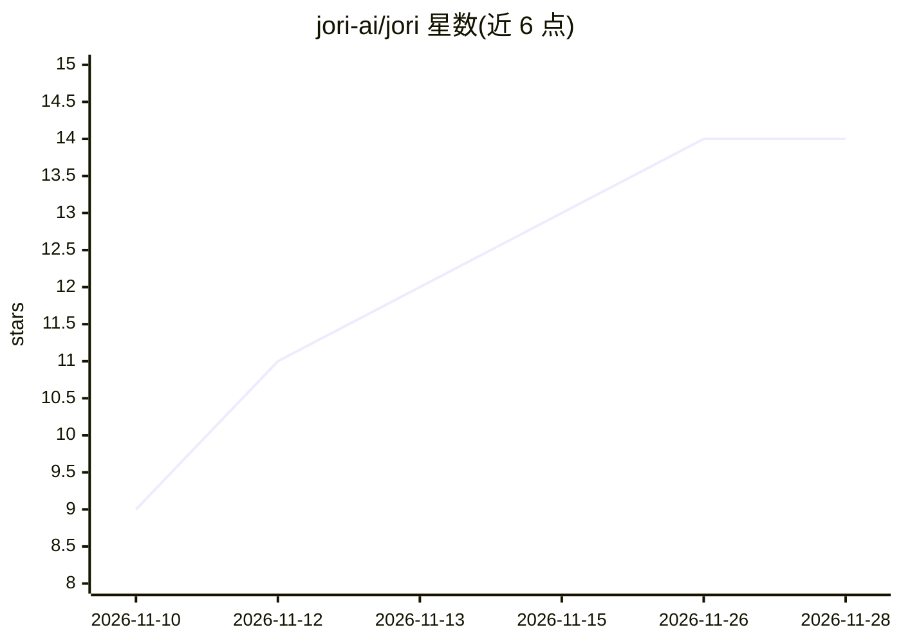

# jori-ai/jori

⭐ 14 · JavaScript · Apache-2.0 · 推送 2026-11-27 · [GitHub](https://github.com/jori-ai/jori) · [官网](https://getjori.ai) · 组织维护

**运行在已有 Claude 订阅上的常驻个人/团队 AI 助手**

开源常驻 AI 助手，可作为个人助手或团队 AI 协作者运行：监控收件箱、管理日历、订餐订票、关注机票票价变动、生成晨报，只在需要时主动发声；涉及花钱等高风险操作需用户确认（如 Face ID 批准）。通过用户已有的 Claude Max 订阅运行，无需 API key 与按 token 计费，订阅不可用时停止而不回退到按 token 计费。基于 Claude Code 的持久化 supervisor、MCP shell bridge、SQLite 记忆层构建，本地 Ollama 模型处理低延迟确认。产品刻意设计为小型内核，集成、记忆库、插件需用户自行配置。

## 筛选速览

| 维度 | 判定 | 备注 |
|---|---|---|
| AI 角色 | `ai-native` | 本体是模型或模型工具 |
| 许可风险 | `permissive` | Apache-2.0 |
| 部署形态 | `None` |  |
| 模型依赖 | local-ok | 支持本地模型 |
| 硬件要求 | — | 无带数字的原话,不猜 |
| 安装摩擦 | `low` | 无编译、无系统依赖或容器化 |
| 成熟度 | — | 结构信号不足 |

## 能力要点

- 运行在已有 Claude 订阅上，无需 API key 与按 token 计费
- 高风险操作（如消费）需用户确认，支持 Face ID 批准
- 约 90 个 CLI 工具，所有功能均为可开关的插件
- 本地 Ollama 模型处理延迟敏感的确认，SQLite 记忆层支持全文+嵌入检索

## 适用场景

- 让助手持续监控收件箱并整理邮件
- 自动寻找跨多人日历的会议时间并订会议
- 关注机票降价、演出票开售等信息并及时提醒
- 作为团队频道里的 AI 协作者处理日程与跟进

## 场景标签

`AI 助手` `Agent 记忆` · 领域:Agent 开发

## 证据(README 行号)

> L7: Most assistants wait. You type, they reply, the moment passes. Jori stays on. It learns what you like, watches what 
> L35: Jori works the other way around. It runs through Anthropic's official Claude environment on the subscription you al
> L41: The agents run only on that subscription (a Claude Max login): Jori never quietly falls back to per-token billing, 

## 星数曲线

2026-11-10 9 → 2026-11-28 14（+5）

---
*卡片 v1 · prompt 1.4 · 生成 2026-11-18 · 置信度 high · 依据 README sha `57900c111c04` · [字段定义](../../DATASET.md)*
