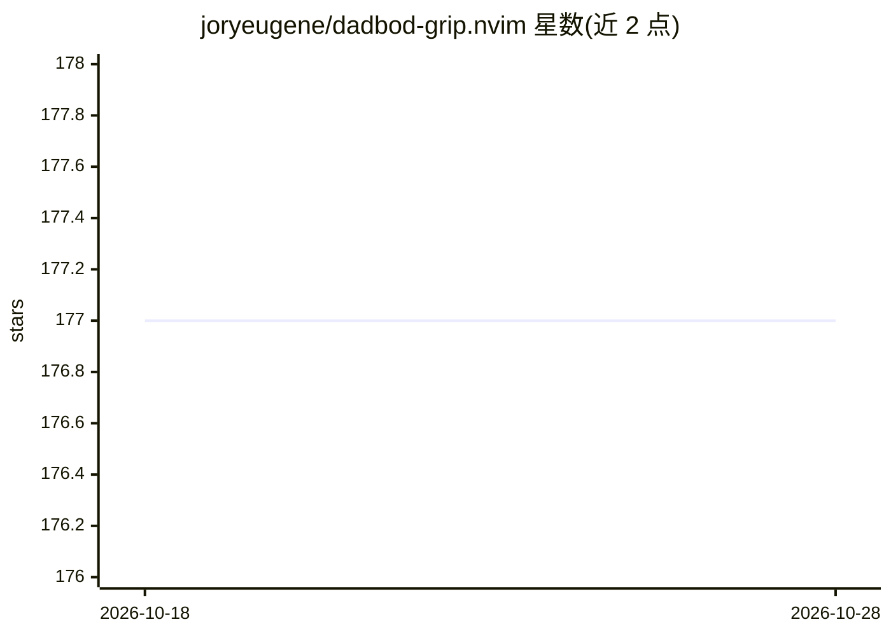

# joryeugene/dadbod-grip.nvim

⭐ 179 · Lua · MIT · 推送 2026-10-17 · [GitHub](https://github.com/joryeugene/dadbod-grip.nvim) · [官网](https://jorypestorious.com/dadbod-grip-web/) · 个人维护

**Neovim 数据库编辑插件：表变成可编辑缓冲区，支持自然语言生成 SQL**

Neovim 插件，把数据库表转为可编辑 Vim 缓冲区，提供 schema 侧栏、SQL 查询板、外键跳转、导入导出与跨数据库联邦（经 DuckDB attach）。所有修改先在内存中暂存，用户审查生成的 SQL 后以单事务应用；密码经环境变量或 stdin 传递。支持 PostgreSQL/MySQL/MariaDB/SQLite/DuckDB/SQL Server，需对应命令行客户端。内置零配置 demo 与 :GripAsk 自然语言生成 SQL（AI 为可选功能，可关闭）。

## 筛选速览

| 维度 | 判定 | 备注 |
|---|---|---|
| AI 角色 | `ai-enhanced` | 去掉 AI 部分产品仍成立 |
| 许可风险 | `permissive` | MIT |
| 部署形态 | `None` |  |
| 模型依赖 | — | README 未给出锁定关系 |
| 硬件要求 | — | 无带数字的原话,不猜 |
| 安装摩擦 | `low` | 无编译、无系统依赖或容器化 |
| 成熟度 | — | 结构信号不足 |

## 能力要点

- 表数据以 Vim 缓冲区编辑，修改暂存并生成 SQL 单事务应用
- DuckDB 驱动的本地/远程文件打开与跨数据库联邦（:GripAttach）
- :GripAsk 从自然语言请求生成 SQL，AI 可整体关闭
- 直接打开 parquet/csv/jsonl/xlsx 等文件格式并支持部分可写

## 适用场景

- 在 Neovim 内浏览 schema、编辑行并审查生成的 SQL 后应用
- 用一条查询跨多个数据库或远程文件（S3/HTTP）做联邦查询
- 通过自然语言生成 SQL 而不离开编辑器

## 场景标签

`数据分析` · 领域:效率与自动化

## 证据(README 行号)

> L10:  Dadbod Grip turns database tables into editable Vim buffers, with schema browsing, staged mutations, generated SQL
> L126: |`:GripAsk`|Generates SQL from a natural-language request.|
> L173: Set `open_sidebar = false` to connect directly into the main workspace. Set `completion = false` when another comp

## 星数曲线

2026-10-18 177 → 2026-10-28 177（+0）

---
*卡片 v1 · prompt 1.4 · 生成 2026-10-22 · 置信度 high · 依据 README sha `1d267157fae8` · [字段定义](../../DATASET.md)*
