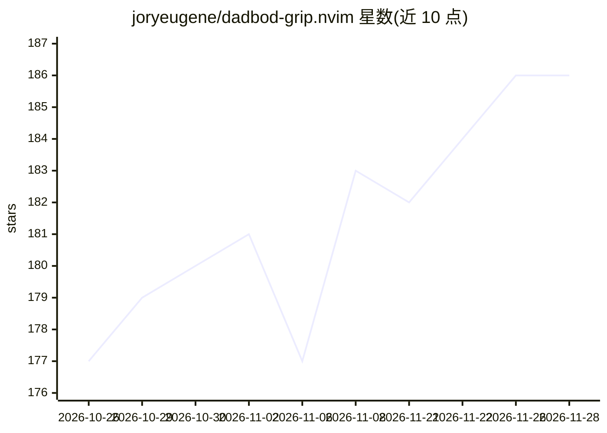

# joryeugene/dadbod-grip.nvim

⭐ 186 · Lua · MIT · 推送 2026-11-03 · [GitHub](https://github.com/joryeugene/dadbod-grip.nvim) · [官网](https://jorypestorious.com/dadbod-grip-web/) · 个人维护

**Neovim 数据库编辑插件：表即缓冲区、分阶段变更、生成 SQL**

将数据库表变成可编辑 Vim 缓冲区的 Neovim 插件（0.10+）：提供 schema 侧栏浏览、用 Vim motions 编辑单元格、外键跳转、查询面板、SQL 历史与结果导出。变更先暂存在内存，审查生成的 SQL 后以单事务应用，可整体撤销或丢弃。支持 PostgreSQL/MySQL/MariaDB/SQLite/DuckDB/SQL Server 连接，并借 DuckDB 实现跨库联邦与本地/远程文件（Parquet/CSV/JSON 等）访问。AI 功能（自然语言生成 SQL）为可选项，可通过配置关闭。

## 筛选速览

| 维度 | 判定 | 备注 |
|---|---|---|
| AI 角色 | `ai-enhanced` | 去掉 AI 部分产品仍成立 |
| 许可风险 | `permissive` | MIT |
| 部署形态 | `None` |  |
| 模型依赖 | — | README 未给出锁定关系 |
| 硬件要求 | — | 无带数字的原话,不猜 |
| 安装摩擦 | `low` | 无编译、无系统依赖或容器化 |
| 成熟度 | — | 结构信号不足 |

## 能力要点

- 表数据在 Vim 缓冲区中直接编辑，变更暂存后单事务应用
- 通过 DuckDB 支持跨数据库联邦查询与本地/远程/S3 文件读取
- :GripAsk 从自然语言请求生成 SQL（可配置关闭）
- 凭据走 stdin/环境变量，避免出现在进程参数中

## 适用场景

- 在 Neovim 里浏览 schema 并用熟悉的按键编辑表数据
- 写 SQL 前先暂存修改、审查生成的语句再提交
- 用 DuckDB 跨多个数据库或 Parquet/CSV 文件做联合查询
- 从自然语言描述生成 SQL 查询

## 场景标签

`代码生成` · 领域:编码与开发

## 证据(README 行号)

> L10:  Dadbod Grip turns database tables into editable Vim buffers, with schema browsing, staged mutations, generated SQL
> L126: |`:GripAsk`|Generates SQL from a natural-language request.|
> L173: Set `open_sidebar = false` to connect directly into the main workspace. Set `completion = false` when another comp

## 星数曲线

2026-10-26 177 → 2026-11-28 186（+9）

---
*卡片 v1 · prompt 1.4 · 生成 2026-11-26 · 置信度 high · 依据 README sha `31f81ea775af` · [字段定义](../../DATASET.md)*
