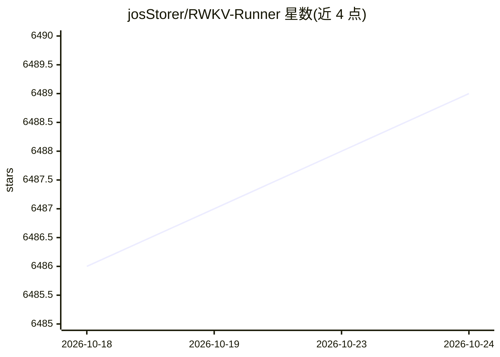

# josStorer/RWKV-Runner

⭐ 6,489 · TypeScript · MIT · 推送 2026-09-04 · [GitHub](https://github.com/josStorer/RWKV-Runner) · [官网](https://www.rwkv.com) · 个人维护 · 中文 README

**RWKV 模型管理与一键启动桌面工具，附带 OpenAI 兼容 API**

面向 RWKV 大语言模型的桌面端管理与启动工具：几 MB 的可执行程序自动完成依赖安装、模型下载与启动，内置对话/补全/作曲交互界面、多级显存预设（支持 WebGPU 在 AMD/Intel 显卡运行）、模型转换、下载管理、LoRA 微调（仅 Windows）。前后端可分离部署，后端推理服务提供 OpenAI 兼容 API（含 embeddings），使 ChatGPT 类客户端可直接接入；也可作为 OpenAI、Ollama 等服务的客户端使用。支持 MIDI 硬件输入与曲目编辑。提供 Windows/macOS/Linux 安装包。

## 筛选速览

| 维度 | 判定 | 备注 |
|---|---|---|
| AI 角色 | `ai-ecosystem` | LLM/agent 周边工具 |
| 许可风险 | `permissive` | MIT |
| 部署形态 | `desktop` | 安装包/桌面程序 |
| 模型依赖 | — | README 未给出锁定关系 |
| 硬件要求 | — | 无带数字的原话,不猜 |
| 安装摩擦 | `medium` | 含编译或系统依赖之一 |
| 成熟度 | — | 结构信号不足 |

## 能力要点

- 几 MB 可执行程序，自动安装依赖、一键启动 RWKV 模型
- 提供 OpenAI 兼容 API（含 embeddings），ChatGPT 客户端可直接接入
- 多级显存预设，WebGPU 策略可运行于 AMD/Intel 显卡
- 内置模型转换、下载管理、LoRA 微调（仅 Windows）

## 适用场景

- 在本地电脑一键部署和运行 RWKV 模型进行对话
- 通过 OpenAI 兼容接口把现有 ChatGPT 客户端接 RWKV
- 服务器部署后端、本机仅作客户端远程调用

## 场景标签

`推理引擎` `聊天机器人` `微调` · 领域:对话与助手

## 证据(README 行号)

> L3: This project aims to eliminate the barriers of using large language models by automating everything for you. All you
> L46: - RWKV model management and one-click startup.
> L52: - Automatic dependency installation, requiring only a lightweight executable program.

## 星数曲线

2026-10-18 6,486 → 2026-10-24 6,489（+3）

---
*卡片 v1 · prompt 1.4 · 生成 2026-10-20 · 置信度 high · 依据 README sha `765228a647e4` · [字段定义](../../DATASET.md)*
