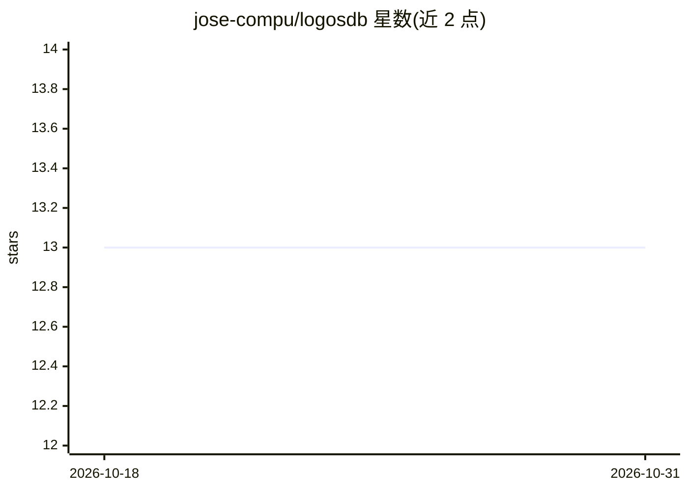

# jose-compu/logosdb

⭐ 13 · C++ · MIT · 推送 2026-10-28 · [GitHub](https://github.com/jose-compu/logosdb) · [官网](https://jose-compu.github.io/logosdb/) · 个人维护

**面向 AI Agent 与 RAG 的嵌入式语义向量数据库（C/C++）**

C/C++ 编写的嵌入式向量数据库，基于 HNSW 提供近似最近邻搜索，向量与文本/时间戳元数据以内存映射二进制文件存储。提供 C API、C++ RAII 封装与 pybind11 Python 绑定（PyPI 提供 Linux/macOS 二进制 wheel），支持时间范围过滤、多种距离度量、批量摄取与 NDJSON 流式导入导出，并带 LangChain/LlamaIndex 适配器及面向 Claude Code 的 MCP server。限制：单进程访问、无内置客户端-服务器、嵌入生成需调用方外部提供。

## 筛选速览

| 维度 | 判定 | 备注 |
|---|---|---|
| AI 角色 | `ai-ecosystem` | LLM/agent 周边工具 |
| 许可风险 | `permissive` | MIT |
| 部署形态 | `library` | 以包/库形式分发 |
| 模型依赖 | locked-api |  |
| 硬件要求 | — | 无带数字的原话,不猜 |
| 安装摩擦 | `medium` | 含编译或系统依赖之一 |
| 成熟度 | — | 结构信号不足 |

## 能力要点

- HNSW 近似最近邻搜索 + 时间戳范围过滤与结构化元数据谓词过滤
- mmap 零拷贝存储，查询内存与数据集规模解耦（10M×384 维典型查询 RAM <200 MB）
- C/C++/Python 三语言接口，PyPI 提供 Linux x86_64/aarch64 与 macOS 双架构 wheel
- logosdb-mcp-server 向 Claude Code 等 MCP 客户端暴露索引/持久记忆/语义搜索能力

## 适用场景

- 为本地 RAG 流水线提供低内存占用的向量检索后端
- 给 AI Agent 做跨会话持久语义记忆
- 在 Claude Code 中索引项目文件并做语义搜索

## 场景标签

`向量数据库` · 领域:知识与检索

## 证据(README 行号)

> L10: LogosDB is a fast semantic vector database written in C/C++ that provides approximate nearest-neighbor search over 
> L48:  * This is not a general-purpose vector database. It is purpose-built for embedding-based memory retrieval in LLM i
> L233: ## Memory-Efficient On-Prem RAG

## 星数曲线

2026-10-18 13 → 2026-10-31 13（+0）

---
*卡片 v1 · prompt 1.4 · 生成 2026-10-31 · 置信度 high · 依据 README sha `f54226614d51` · [字段定义](../../DATASET.md)*
