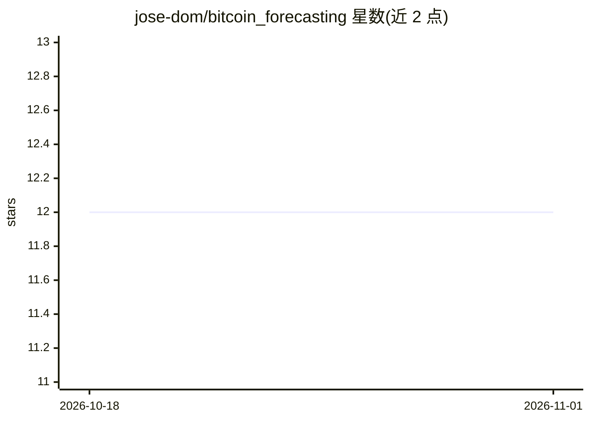

# jose-dom/bitcoin_forecasting

⭐ 12 · Jupyter Notebook · 推送 2026-02-22 · [GitHub](https://github.com/jose-dom/bitcoin_forecasting) · [官网](https://jose-dom.com/post/67/) · 个人维护

**用 VAR/XGBoost/Prophet 预测比特币价格的 Jupyter 笔记本项目**

一个 Jupyter 笔记本项目：基于华尔街日报报道中比特币上涨与美元对冲关系的背景，使用 Yahoo Finance 的比特币历史数据与 Investing.com 的美元指数期货历史数据，探索数据关系并用 VAR、XGBoost、Facebook Prophet 等模型拟合预测比特币价格。数据源免费可下载，README 未提供安装命令或依赖说明，适合关注金融时间序列预测的开发者与学习者参考复现。

## 筛选速览

| 维度 | 判定 | 备注 |
|---|---|---|
| AI 角色 | `ai-native` | 本体是模型或模型工具 |
| 许可风险 | `none` | — |
| 部署形态 | `None` |  |
| 模型依赖 | — | README 未给出锁定关系 |
| 硬件要求 | — | 无带数字的原话,不猜 |
| 安装摩擦 | `low` | 无编译、无系统依赖或容器化 |
| 成熟度 | — | 结构信号不足 |

## 能力要点

- 使用 VAR、XGBoost、Facebook Prophet 三类模型预测比特币价格
- 数据源为 Yahoo Finance 比特币历史与 Investing.com 美元指数期货历史
- 以 Jupyter 笔记本形式呈现分析过程

## 适用场景

- 复现比特币价格的多模型时间序列预测实验
- 学习 VAR/XGBoost/Prophet 在金融数据上的应用
- 分析比特币与美元指数的关系

## 场景标签

 · 领域:金融/时间序列预测

## 证据(README 行号)

> L3: Based on a report by the Wall Street Journal, Bitcoin is surging due to an increase in investor enthusiasm and techn

## 星数曲线

2026-10-18 12 → 2026-11-01 12（+0）

---
*卡片 v1 · prompt 1.4 · 生成 2026-11-01 · 置信度 high · 依据 README sha `c60dd11f7841` · [字段定义](../../DATASET.md)*
