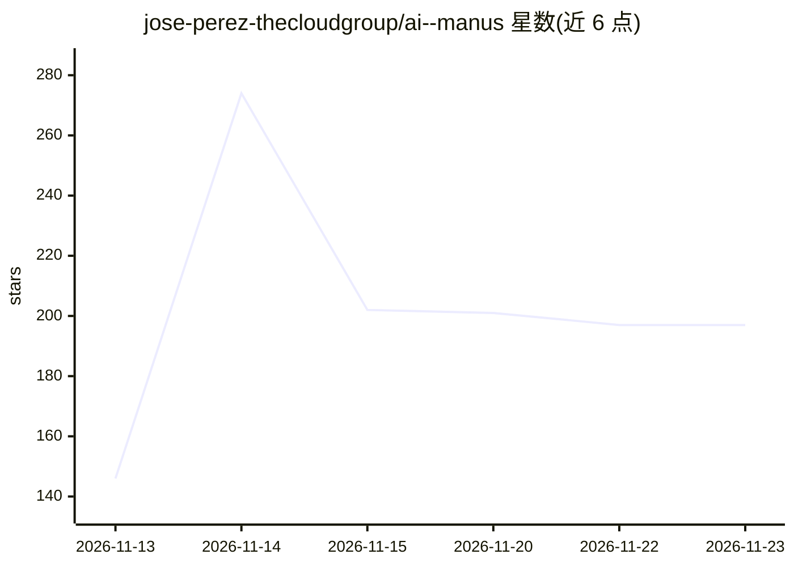

# jose-perez-thecloudgroup/ai--manus

⭐ 197 · Apache-2.0 · 推送 2026-11-13 · [GitHub](https://github.com/jose-perez-thecloudgroup/ai--manus) · 组织维护

**面向日常任务的自主 AI Agent：自动执行代码与浏览器操作**

README 描述的通用型自主 AI Agent，面向学生、远程工作者与轻量办公用户：代替用户编写并执行脚本、控制浏览器完成导航、表单填写与信息收集，并可在后台执行多步骤日常任务。定位为家用/学习/小型任务助手，明确排除企业级平台场景。给出最低（双核 CPU、4GB 内存）与推荐硬件配置表。README 未提供具体安装命令、技术架构、模型接入方式或代码仓库内容，仅有营销式功能描述与'PROMO2026'下载提示，可验证技术细节有限。

## 筛选速览

| 维度 | 判定 | 备注 |
|---|---|---|
| AI 角色 | `ai-native` | 本体是模型或模型工具 |
| 许可风险 | `permissive` | Apache-2.0 |
| 部署形态 | `None` |  |
| 模型依赖 | — | README 未给出锁定关系 |
| 硬件要求 | — | 无带数字的原话,不猜 |
| 安装摩擦 | `low` | 无编译、无系统依赖或容器化 |
| 成熟度 | — | 结构信号不足 |

## 能力要点

- 自主执行代码：Agent 自行编写并运行脚本完成任务
- 浏览器控制：代替用户完成网页导航、表单填写与信息收集
- 跨会话保持任务模式，脚本与浏览器操作可在同一流程中衔接
- 给出最低/推荐硬件兼容表（双核 CPU、4GB/8GB 内存）

## 适用场景

- 让 Agent 代替人工完成重复性的代码运行与网页操作
- 学习与研究中收集资料、运行小脚本、整理笔记
- 远程办公时从多个网页汇总信息、准备小型报告

## 场景标签

`编码 Agent` `浏览器自动化` · 领域:效率与自动化

## 证据(README 行号)

> L10: - **Autonomous Code Execution:** Manus AI agent runs code on its own to complete tasks, so you can focus on decisio
> L18: Manus is an autonomous AI agent designed to run code and control a browser on your behalf. Instead of acting like a

## 星数曲线

2026-11-13 146 → 2026-11-23 197（+51）

---
*卡片 v1 · prompt 1.4 · 生成 2026-11-17 · 置信度 low · 依据 README sha `66ba5de9af15` · [字段定义](../../DATASET.md)*
