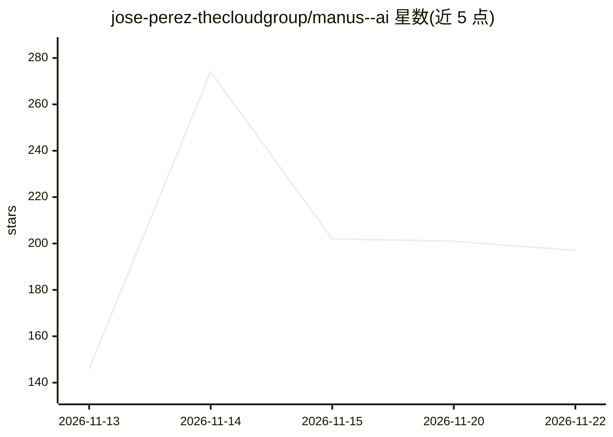

# jose-perez-thecloudgroup/manus--ai

⭐ 197 · Apache-2.0 · 推送 2026-11-13 · [GitHub](https://github.com/jose-perez-thecloudgroup/manus--ai) · 组织维护

**面向日常任务的自主 AI 代理：自动执行代码与浏览器操作**

自称 Manus 的自主 AI Agent，定位为代替用户执行代码与浏览器操作的个人助手：可编写并运行脚本、打开网页、填写表单、执行多步骤任务，代码与浏览器动作可在同一流程内衔接。目标用户为学生、远程工作者与有小项目的个人，用于整理研究资料、多页面数据收集、轻量办公等场景。README 为营销式描述，给出系统兼容性表（最低 4GB 内存、双核 CPU）与使用步骤建议，但未提供安装命令、源码说明或技术架构细节。

## 筛选速览

| 维度 | 判定 | 备注 |
|---|---|---|
| AI 角色 | `ai-native` | 本体是模型或模型工具 |
| 许可风险 | `permissive` | Apache-2.0 |
| 部署形态 | `None` |  |
| 模型依赖 | — | README 未给出锁定关系 |
| 硬件要求 | — | 无带数字的原话,不猜 |
| 安装摩擦 | `low` | 无编译、无系统依赖或容器化 |
| 成熟度 | — | 结构信号不足 |

## 能力要点

- 自主编写并执行代码完成多步任务
- 浏览器控制：导航网页、填表、收集信息
- 代码执行与浏览器操作在同一流程内衔接
- 后台常驻的个人助手模式，跨会话复用工作流模式

## 适用场景

- 让学生整理研究笔记、跑快速计算
- 让代理跨多个网页收集数据并汇总
- 把重复性小任务委托给代理后台处理

## 场景标签

`AI 助手` `编码 Agent` `浏览器自动化` · 领域:效率与自动化

## 证据(README 行号)

> L10: - **Autonomous Code Execution:** Manus AI agent runs code on its own to complete tasks, so you can focus on decisio
> L18: Manus is an autonomous AI agent designed to run code and control a browser on your behalf. Instead of acting like a

## 星数曲线

2026-11-13 146 → 2026-11-22 197（+51）

---
*卡片 v1 · prompt 1.4 · 生成 2026-11-17 · 置信度 mid · 依据 README sha `66ba5de9af15` · [字段定义](../../DATASET.md)*
