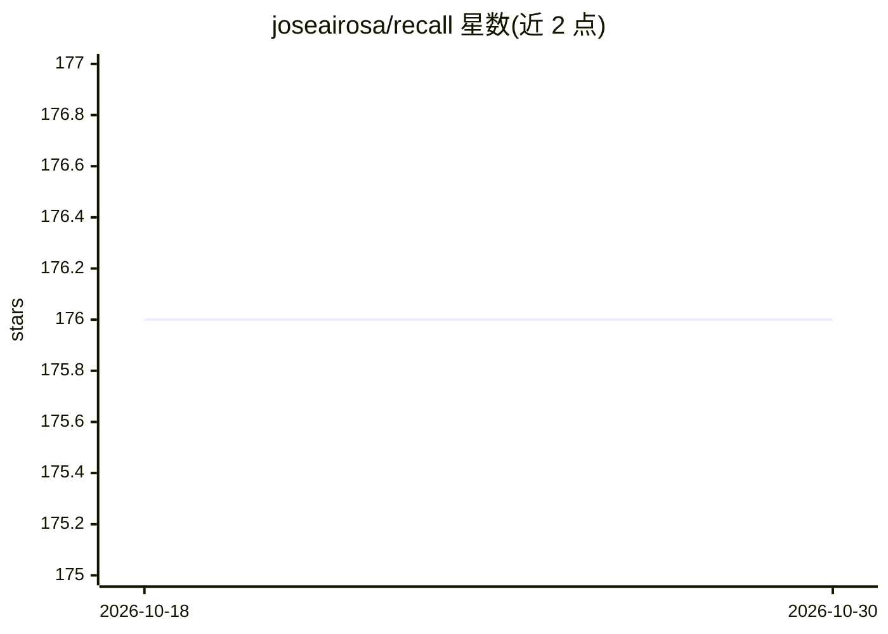

# joseairosa/recall

⭐ 176 · TypeScript · MIT · 推送 2026-10-26 · [GitHub](https://github.com/joseairosa/recall) · 个人维护

**给 Claude/AI agent 的跨会话持久记忆 MCP 服务器**

面向 Claude Desktop/Claude Code 及其他 AI agent 的 MCP 记忆服务器：将决策、代码模式等知识持久存储到自有 Redis(≥6)/Valkey 实例，跨会话、跨上下文压缩自动检索，按 workspace 隔离，支持 7 种嵌入提供商或 Anthropic 关键词回退，可离线部署。另提供托管 SaaS（recallmcp.com，免费 500 条记忆起），仓库内为 MIT 许可的自托管方案。自托管需 Node.js ≥18 与 Redis/Valkey，经 npm/npx/源码安装；另有 Claude Code 插件脚本，含 RLM 大文件分块分析命令与自动 hooks。README 附带安全免责声明：记忆库可能含敏感信息，存储安全由使用者负责。

## 筛选速览

| 维度 | 判定 | 备注 |
|---|---|---|
| AI 角色 | `ai-ecosystem` | LLM/agent 周边工具 |
| 许可风险 | `permissive` | MIT |
| 部署形态 | `self-host` | docker 或自建部署 |
| 模型依赖 | — | README 未给出锁定关系 |
| 硬件要求 | — | 无带数字的原话,不猜 |
| 安装摩擦 | `low` | 无编译、无系统依赖或容器化 |
| 成熟度 | — | 结构信号不足 |

## 能力要点

- 记忆持久化于自有 Redis/Valkey，跨会话与上下文压缩存活
- 支持 7 种嵌入提供商（Voyage/Cohere/OpenAI/Deepseek/Grok/Anthropic/Ollama）或关键词回退
- 按 workspace 组织隔离，支持气隙离线部署
- 提供 Claude Code 插件：/load-context、/decompose 等 RLM 命令与自动 hooks

## 适用场景

- 让 Claude Code 在长期项目中记住我的编码偏好与架构决策
- 团队在自托管基础设施上为 AI agent 共享持久记忆
- 上下文窗口经常被填满时保留关键上下文

## 场景标签

`Agent 记忆` · 领域:Agent 开发

## 证据(README 行号)

> L3: **Persistent cross-session memory for Claude and other AI agents. Survives context limits, session restarts, and com
> L96: Recall is a **brain extension** for Claude that stores memories persistently. It solves the context window problem 
> L262: npx @modelcontextprotocol/create-server @joseairosa/recall

## 星数曲线

2026-10-18 176 → 2026-10-30 176（+0）

---
*卡片 v1 · prompt 1.4 · 生成 2026-10-22 · 置信度 mid · 依据 README sha `999b9cf4f25e` · [字段定义](../../DATASET.md)*
