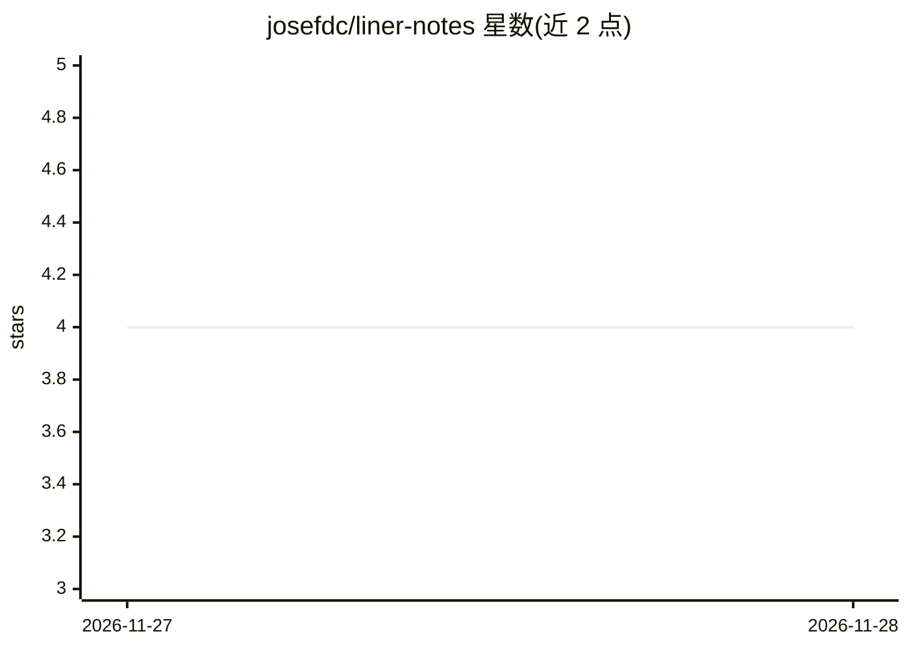

# josefdc/liner-notes

⭐ 4 · TypeScript · AGPL-3.0 · 推送 2026-11-06 · [GitHub](https://github.com/josefdc/liner-notes) · [官网](https://josefdc.github.io/liner-notes/) · 个人维护

**追溯歌曲采样与历史并标注每个论断依据的音乐研究 agent**

输入歌名即生成该曲的采样、翻唱、混音关系图谱与说明文字，并对每个论断标注来源类型：measured（音频实测）、sourced（引用记录并核验）、inferred（模型推断）、missing。内部由 LangGraph 编排多个角色节点：scout 定轨、engineer 取预览音频并用 Essentia 实测、historian 从 MusicBrainz 等来源汇集证据包、composer 撰写、verifier 逐条核验。带评估集与已知局限说明；实时分析需自备 Spotify 与 Azure OpenAI 密钥。

## 筛选速览

| 维度 | 判定 | 备注 |
|---|---|---|
| AI 角色 | `ai-native` | 本体是模型或模型工具 |
| 许可风险 | `viral` | AGPL-3.0 |
| 部署形态 | `self-host` | docker 或自建部署 |
| 模型依赖 | locked-api |  |
| 硬件要求 | — | 无带数字的原话,不猜 |
| 安装摩擦 | `low` | 无编译、无系统依赖或容器化 |
| 成熟度 | — | 结构信号不足 |

## 能力要点

- 每个论断按 measured/sourced/inferred/missing 标注来源类型
- verifier 对变异论断的检出率 98.1%（53/54），幻觉采样 0/5
- scout/engineer/historian/composer/verifier 多角色 LangGraph 流水线
- 评估集报告、运行记录与失败案例随仓库公开

## 适用场景

- 查证一首歌的采样来源与制作署名
- 生成带出处的乐史说明与歌曲关系时间线
- 研究 LLM 论断可验证性的评估方法

## 场景标签

`科研工具` · 领域:学习与行业

## 证据(README 行号)

> L3: **Type a song. Get its samples, credits and history, and see how every claim is known.**
> L5: An open-source AI agent for music research that keeps the model honest: measured values come from
> L6: the audio, relations come from primary records, and a verifier checks what the model writes against

## 星数曲线

2026-11-27 4 → 2026-11-28 4（+0）

---
*卡片 v1 · prompt 1.4 · 生成 2026-11-27 · 置信度 mid · 依据 README sha `a2fd0153fb72` · [字段定义](../../DATASET.md)*
