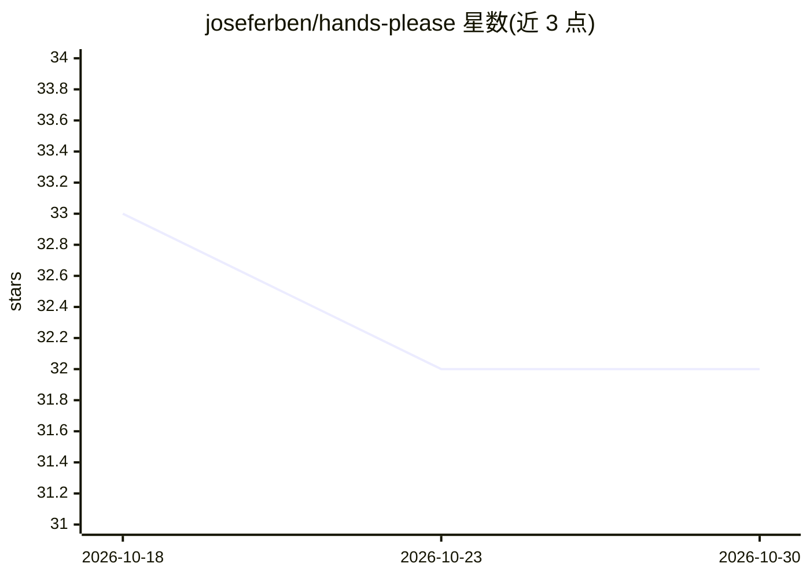

# joseferben/hands-please

⭐ 32 · TypeScript · 推送 2026-10-27 · [GitHub](https://github.com/joseferben/hands-please) · 个人维护

**监控代码注释并后台运行编码 agent 的 CLI 工具**

Node.js CLI 工具：监视代码库中以 @ai 开头的注释（如 // @ai fix this code），将其作为提示词在后台运行编码 agent（如 Claude Code），循环执行文件级检查与全库检查直至 lint/build 通过，失败则将错误反馈给 agent 重试。无聊天界面，交互完全通过代码注释完成。通过 npx/pnpm dlx 以命令行参数配置，示例中使用 Claude Code 作为 agent。

## 筛选速览

| 维度 | 判定 | 备注 |
|---|---|---|
| AI 角色 | `ai-ecosystem` | LLM/agent 周边工具 |
| 许可风险 | `none` | — |
| 部署形态 | `library` | 以包/库形式分发 |
| 模型依赖 | — | README 未给出锁定关系 |
| 硬件要求 | — | 无带数字的原话,不猜 |
| 安装摩擦 | `low` | 无编译、无系统依赖或容器化 |
| 成熟度 | — | 结构信号不足 |

## 能力要点

- 监视 @ai 注释并将其转化为 agent 提示词
- 循环执行 --file-check 与 --check 直至通过，失败自动重试
- 支持任意以命令行方式调用的编码 agent
- 无聊天界面，交互仅通过代码注释

## 适用场景

- 在代码里留注释让 agent 后台自动修复或补测试
- 基于 lint 错误自动触发 agent 修码
- 希望以精确范围而非全对话方式运行编码 agent

## 场景标签

`编码 Agent` · 领域:编码与开发

## 证据(README 行号)

> L7: 1. Watch codebase for `// @ai fix this code`
> L8: 2. Run an agent like Claude Code in the background with the prompt from the comment until lint/build passes

## 星数曲线

2026-10-18 33 → 2026-10-30 32（-1）

---
*卡片 v1 · prompt 1.4 · 生成 2026-10-26 · 置信度 high · 依据 README sha `6c53602e658a` · [字段定义](../../DATASET.md)*
