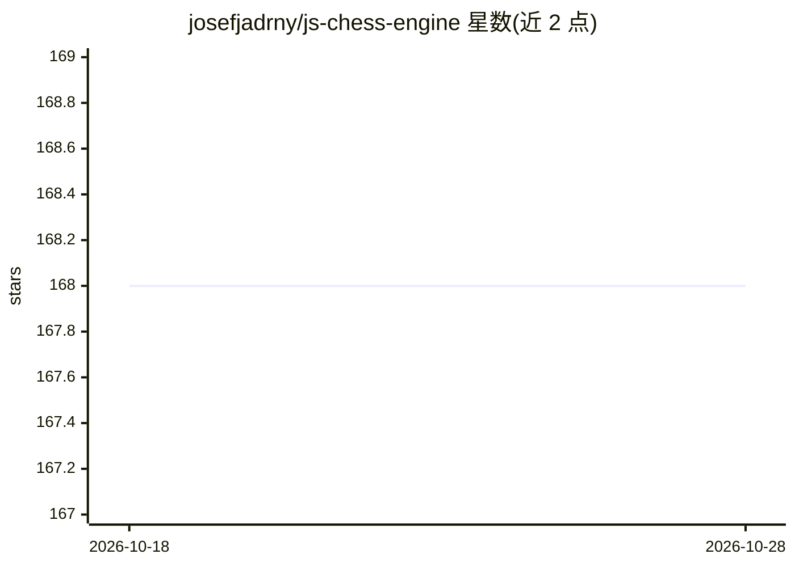

# josefjadrny/js-chess-engine

⭐ 168 · TypeScript · MIT · 推送 2026-02-22 · [GitHub](https://github.com/josefjadrny/js-chess-engine) · [官网](http://chess.josefjadrny.info/) · 个人维护

**零依赖的 TypeScript 国际象棋引擎，供 Node.js 与浏览器使用**

纯 TypeScript 编写的国际象棋引擎库，无第三方依赖，运行于 Node.js >=24 与浏览器环境。提供有状态的 Game 类与无状态函数两套 API，支持 JSON 与 FEN 两种棋局表示、走子/合法走法查询、历史记录、控制台棋盘打印。内置基于搜索的 AI（5 个难度等级，可配置深度、置换表、随机性参数），返回最佳走法与局面。限制：v2 要求 Node.js >=24，aiMove/aiMove 方法已标记将在 v3.0.0 移除。

## 筛选速览

| 维度 | 判定 | 备注 |
|---|---|---|
| AI 角色 | `ai-enhanced` | 去掉 AI 部分产品仍成立 |
| 许可风险 | `permissive` | MIT |
| 部署形态 | `library` | 以包/库形式分发 |
| 模型依赖 | — | README 未给出锁定关系 |
| 硬件要求 | — | 无带数字的原话,不猜 |
| 安装摩擦 | `low` | 无编译、无系统依赖或容器化 |
| 成熟度 | — | 结构信号不足 |

## 能力要点

- 有状态 Game 类与无状态函数两套 API，共享同一置换表缓存
- AI 提供 5 个难度等级，支持深度、置换表大小、随机性等参数配置
- 支持 JSON BoardConfig 与 FEN 格式的导入导出与互转
- 提供服务器端与纯浏览器两个示例应用

## 适用场景

- 在 Node.js 或浏览器中构建国际象棋对局应用
- 接入 AI 对手并与不同难度的引擎对弈
- 做 FEN 与 JSON 棋局格式的解析与状态计算

## 场景标签

 · 领域:游戏/棋类引擎

## 证据(README 行号)

> L6: Complete TypeScript chess engine without dependencies for Node.js >=24 and browsers. Includes configurable AI with d
> L150: **aiMove**

## 星数曲线

2026-10-18 168 → 2026-10-28 168（+0）

---
*卡片 v1 · prompt 1.4 · 生成 2026-10-22 · 置信度 high · 依据 README sha `29845be6ddaf` · [字段定义](../../DATASET.md)*
