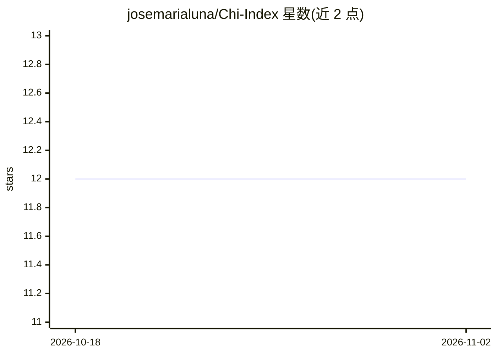

# josemarialuna/Chi-Index

⭐ 12 · Python · MIT · 推送 2026-09-20 · [GitHub](https://github.com/josemarialuna/Chi-Index) · [官网](https://www.sciencedirect.com/science/article/pii/S0020025519301550) · 个人维护

**基于卡方的聚类外部有效性指标 Python 包**

实现 Luna-Romera 等 2019 年 Information Sciences 论文提出的 Chi Index：用两个归一化 Pearson 卡方统计量评估聚类划分与已知类别标签的吻合度，分数范围 0-2、越大越好，适用于任意硬聚类算法。论文实验用 Spark，本包改为本地运行，依赖 NumPy、pandas、SciPy 与 scikit-learn。提供独立评分函数与 ChiIndex 类（在给定 k 范围内拟合 K-means 并选最优 k），支持可选绘图与结果表导出。

## 筛选速览

| 维度 | 判定 | 备注 |
|---|---|---|
| AI 角色 | `ai-ecosystem` | LLM/agent 周边工具 |
| 许可风险 | `permissive` | MIT |
| 部署形态 | `library` | 以包/库形式分发 |
| 模型依赖 | — | README 未给出锁定关系 |
| 硬件要求 | — | 无带数字的原话,不猜 |
| 安装摩擦 | `low` | 无编译、无系统依赖或容器化 |
| 成熟度 | — | 结构信号不足 |

## 能力要点

- chi_index_score 独立评分函数，适用于任意硬聚类算法的划分评估
- ChiIndex 类在指定 k 范围内拟合 K-means 并按 Chi Index 选择最优 k
- 要求 Python 3.10+，本地运行（NumPy/pandas/SciPy/scikit-learn），无需 Spark
- 可选 plot 附加组件导出质心图，测试覆盖论文列联表与不变性等性质

## 适用场景

- 为我的聚类结果计算与真实标签对照的外部有效性分数
- 自动遍历 K-means 的 k 值并选出最优簇数
- 复现论文中的 Chi Index 计算与列联表结果

## 场景标签

`模型评测` · 领域:评测与运维

## 证据(README 行号)

> L11: Chi Index evaluates a clustering partition against known class labels using
> L19: The paper's experiments used Spark; this package runs locally with NumPy,

## 星数曲线

2026-10-18 12 → 2026-11-02 12（+0）

---
*卡片 v1 · prompt 1.4 · 生成 2026-11-01 · 置信度 high · 依据 README sha `00ff017ac4ae` · [字段定义](../../DATASET.md)*
